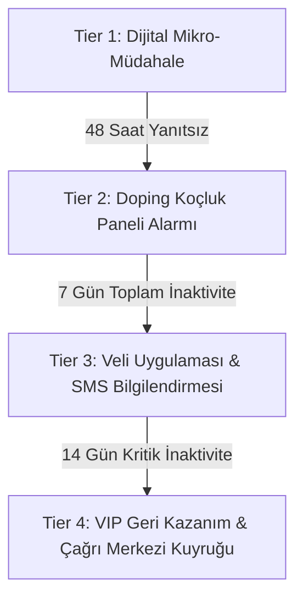

# 🛡️ Doping Pulse: Veli ve Koçluk Eskalasyon Motoru Spesifikasyonu

**Doküman Kodu:** `RFC-PULSE-005`  
**Modül:** `Pulse Escalation & Stakeholder Notification Engine`  
**Yazar:** Hamza Kar  
**Kapsam:** Dijital mikro-müdahalelere yanıt vermeyen veya kritik kopuş eşiğini aşan öğrenciler için insan faktörünü (Doping Koçu & Veli) devreye sokan kademeli alarm altyapısı.

---

## 1. Mimari Felsefe ve Problem Tanımı

Sadece öğrencinin ekranına kart basmak veya push bildirimi göndermek her zaman yeterli değildir.  
Özellikle 12-18 yaş grubundaki öğrencilerde:
1. **İnkar ve Kaçınma:** Uygulamayı tamamen silme veya bildirimleri kapatma eğilimi olabilir.
2. **Kritik Eşik:** Bir öğrenci 7 günden fazla sistemden koparsa, geri dönüş olasılığı %70 oranında düşer.

**Temel Prensip: "Şikayet Etme, Çözüm Sun"**  
Eskalasyon motoru veliye gidip asla *"Çocuğunuz sisteme hiç girmiyor, ders çalışmıyor!"* gibi suçlayıcı bir dille bildirim göndermez.  
Bunun yerine yapıcı ve koçluk odaklı bir köprü kurar:  
> *"Ahmet'in haftalık çalışma ritminde küçük bir aksama fark ettik. Çalışma programını hafifletmek veya Doping rehberlik uzmanımızla görüşmek ister misiniz?"*

---

## 2. Kademeli Eskalasyon Seviyeleri

Eskalasyon motoru 4 seviyeli bir eskalasyon matrisi işletir:



| Seviye | Tetiklenme Koşulu | Hedef Kitle | Kanal | Aksiyon |
| :--- | :--- | :--- | :--- | :--- |
| **Tier 1 (Soft)** | Durum `BOOST` veya `RESTART_CHECKIN_PENDING` | Öğrenci | Mobil Push / In-App Modal | Mikro-görev kartı veya 2 soruluk check-in anketi. |
| **Tier 2 (Coach)** | `RESTART_UNRESPONSIVE` (Ankete 48 saat yanıt yok) OR `ACTIVATE_STALLED` (5 gün hareketsiz) | Doping Öğrenci Koçu | Koç CRM Dashboard & WebSocket | Koçun günlük görüşme listesine otomatik "Kopuş Riski" görevi atanır. |
| **Tier 3 (Guardian)** | 7+ gün ardışık sıfır aktivite (`ACTIVATE_CRITICAL` veya `RESTART` 7. gün) | Veli | Veli Mobil Uygulaması Push + SMS | Veliye durum özeti ve tek tıkla koç randevusu alma butonu. |
| **Tier 4 (Churn)** | 14+ gün inaktif AND Veli/Öğrenci teması kurulamadı | Başarı / Retansiyon Ekibi | CRM Outbound Çağrı Kuyruğu | Birebir telefon araması ile churn önleme görüşmesi. |

---

## 3. Eskalasyon Veri Modeli (`pulse_escalation_records`)

Eskalasyon geçmişini ve durumunu takip eden ilişkisel tablo yapısı:

```sql
CREATE TYPE escalation_tier_enum AS ENUM ('TIER_1_STUDENT', 'TIER_2_COACH', 'TIER_3_GUARDIAN', 'TIER_4_RETENTION');
CREATE TYPE escalation_channel_enum AS ENUM ('IN_APP_CARD', 'PUSH_NOTIFICATION', 'COACH_CRM_TASK', 'GUARDIAN_SMS', 'OUTBOUND_CALL');
CREATE TYPE escalation_status_enum AS ENUM ('TRIGGERED', 'DISPATCHED', 'ACKNOWLEDGED', 'RESOLVED', 'FAILED');

CREATE TABLE pulse_escalation_records (
    escalation_id       UUID PRIMARY KEY DEFAULT gen_random_uuid(),
    student_id          UUID NOT NULL REFERENCES pulse_student_states(student_id) ON DELETE CASCADE,
    tier                escalation_tier_enum NOT NULL,
    channel             escalation_channel_enum NOT NULL,
    status              escalation_status_enum NOT NULL DEFAULT 'TRIGGERED',
    trigger_reason      VARCHAR(128) NOT NULL, -- 'UNRESPONSIVE_CHECKIN_48H', 'INACTIVE_7_DAYS'
    assigned_coach_id   UUID NULL,             -- Görev atanan koç ID
    recipient_contact   VARCHAR(64) NULL,      -- Maskelenmiş veli telefon veya email
    payload_metadata    JSONB NOT NULL DEFAULT '{}'::jsonb,
    triggered_at        TIMESTAMPTZ NOT NULL DEFAULT NOW(),
    acknowledged_at     TIMESTAMPTZ NULL,      -- Koç görevi açtığı an
    resolved_at         TIMESTAMPTZ NULL       -- Öğrenci sisteme geri döndüğü an
);

CREATE INDEX idx_escalation_active ON pulse_escalation_records (student_id, status);
CREATE INDEX idx_escalation_coach ON pulse_escalation_records (assigned_coach_id, status) WHERE status = 'DISPATCHED';
```

---

## 4. Doping Koçluk Paneli Webhook Entegrasyonu

Tier 2 seviyesinde, Pulse motoru Doping Koçluk Sistemi'ne asenkron bir webhook fırlatır:

### `POST /api/v1/coaching-service/tasks/pulse-alert`
```json
{
  "eventId": "esc_99182312-3344",
  "studentId": "c3a1b8d2-45e0-4789-9a21-998877665544",
  "studentName": "Ahmet Yılmaz",
  "gradeLevel": "12_YKS_SAYISAL",
  "escalationTier": "TIER_2_COACH",
  "alertReason": "Öğrenci 4 gün önce ReStart anketine alındı fakat 48 saattir sisteme girmedi.",
  "contextSummary": {
    "consecutiveInactiveDays": 5,
    "lastStudiedTopic": "Matematik - Trigonometri 2",
    "historicalDailyAverageMinutes": 45,
    "currentPulseState": "RESTART",
    "suggestedCoachAction": "Öğrenciyi arayarak Trigonometri konusundaki zorlanmasını sor veya sınav haftasında olup olmadığını öğren."
  },
  "priority": "HIGH",
  "dueWithinHours": 24
}
```

---

## 5. Veli Bilgilendirme ve İletişim Protokolü

Tier 3 seviyesinde veliye gönderilecek içerikler şablon motoruyla üretilir:

### 5.1. Veli Push Bildirimi
* **Başlık:** Doping Hafıza Öğrenci Takibi 📊
* **Mesaj:** *"Ahmet bu hafta çalışma programına kısa bir ara verdi. Programını hafifletmek veya koçumuzla görüşmek için dokunun."*
* **Deep Link:** `dopingveli://coaching/book-session?studentId=c3a1b8d2`

### 5.2. Veli SMS Şablonu
> *"Sayın Velimiz, öğrencimiz Ahmet Yılmaz'ın Doping Hafıza çalışma serisinde 7 günlük bir duraksama tespit ettik. Öğrencimizin motivasyonunu desteklemek için haftalık hedeflerini yeniden düzenleyebilir veya koçluk desteği talep edebilirsiniz: https://doping.link/koc-destek"*

---

## 6. Güvenlik, Frekans Sınırlama ve Anti-Spam

Veliyi ve koçları sürekli bildirimlerle bıktırmamak için motor üzerinde katı kurallar uygulanır:

1. **Veli İletişimi Sıklık Sınırı:**  
   Bir veliye **14 gün içinde en fazla 1 kez** Tier 3 SMS/Push bildirimi gönderilebilir. Öğrenci inaktif kalmaya devam etse dahi art arda SMS atılmaz.
2. **Otomatik Çözümleme:**  
   Eğer öğrenci eskalasyon kaydı açıkken sisteme girip herhangi bir dersi tamamlarsa (`LessonWatchedEvent` veya `QuizCompletedEvent`), açık olan tüm eskalasyon kayıtları otomatik olarak `status = 'RESOLVED'` yapılır ve koçun ekranındaki alarm kaldırılır.
3. **KVKK / İletişim İzinleri Kontrolü:**  
   Veliye herhangi bir SMS veya dış bildirim gönderilmeden önce Doping İletişim İzinleri Servisi (`ConsentService`) doğrulanır; ticari/operasyonel izin yoksa sadece uygulama içi pasif karta izin verilir.
4. **Sessiz Saatler:**  
   Veliye SMS ve push bildirimleri yalnızca **09:00 – 21:00** (`Europe/Istanbul`) arasında gönderilir. Gece batch'inde tetiklenen Tier 3 bildirimleri aynı sabah 09:00 – 09:30 arasına dağıtılarak gönderilir. Gönderim anında eskalasyon kaydı `RESOLVED` olduysa (öğrenci o arada derse girdiyse) bildirim iptal edilir (RFC-004 §5.1).
