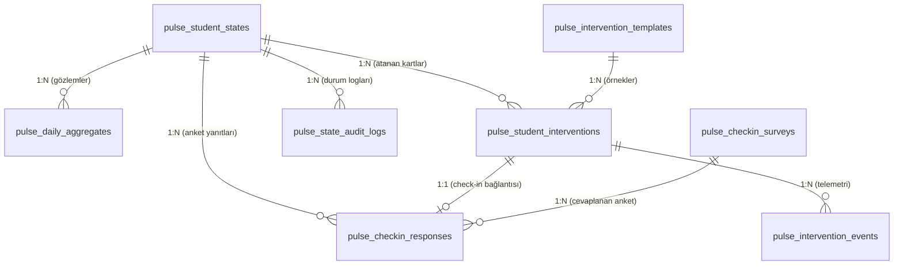

# 🗄️ Doping Pulse: Veritabanı Mimarisi, Şema ve İndeksleme Spesifikasyonu

**Doküman Kodu:** `RFC-PULSE-002`  
**Modül:** `Pulse Data Layer & Storage Engine`  
**Yazar:** Hamza Kar  
**Hedef RDBMS:** PostgreSQL 16+  
**Tasarım Hedefi:** Yüz binlerce aktif öğrencinin eşzamanlı aksiyonlarını kaldırabilecek, düşük gecikmeli (sub-10ms), partitioned ve B-tree optimizasyonlu veri katmanı.

---

## 1. Mimari Kararlar ve Tasarım Prensipleri

### 1.1. Neden PostgreSQL 16+?
1. **Zengin JSONB Desteği & GIN İndeksleri:** Müdahale şablonları (`config_payload`) ve anket cevapları gibi değişken şemalı verileri NoSQL esnekliğinde tutarken ACID bütünlüğünü korur.
2. **Deklaratif Partitioning:** Milyonlarca günlük aktivite ve telemetri kaydını performans kaybı olmadan aylık pencerelere ayırır.
3. **Kısmi İndeksler:** Yalnızca aktif müdahaleleri (`WHERE status = 'ASSIGNED'`) indeksleyerek RAM kullanımını %80 oranında düşürür.

### 1.2. UUIDv7 Seçimi
Standart `UUIDv4` tamamen rastgeledir ve yüksek hacimli INSERT'lerde B-Tree indekslerinde ciddi page fragmentation'a yol açar.  
Doping Pulse'ta birincil anahtarlar için **zaman sıralı UUIDv7** kullanılır. Bu sayede hem dağıtık sistemlerde çakışmasız ID üretilir hem de sıralı B-Tree yazma performansı elde edilir.

---

## 2. ER Diyagramı



---

## 3. DDL Tanımları

### 3.1. `pulse_student_states`: Durum Çekirdek Tablosu
Öğrencinin anlık durumunu, aktif müdahalesini ve kilit metriklerini tutan ana tablodur.

```sql
CREATE TYPE pulse_state_enum AS ENUM ('ACTIVATE', 'BOOST', 'RESTART', 'STEADY');
CREATE TYPE pulse_sub_state_enum AS ENUM (
    'ACTIVATE_ONBOARDING', 'ACTIVATE_STALLED', 'ACTIVATE_CRITICAL',
    'BOOST_STREAK_BROKEN', 'BOOST_LOW_PACE', 'BOOST_BURNOUT_RISK',
    'RESTART_CHECKIN_PENDING', 'RESTART_ADAPTED', 'RESTART_UNRESPONSIVE',
    'STEADY_NORMAL', 'STEADY_STREAK_HERO'
);

CREATE TABLE pulse_student_states (
    student_id                  UUID PRIMARY KEY, -- Doping Core Auth UUID
    current_state               pulse_state_enum NOT NULL DEFAULT 'ACTIVATE',
    current_sub_state           pulse_sub_state_enum NOT NULL DEFAULT 'ACTIVATE_ONBOARDING',
    previous_state              pulse_state_enum NULL,
    state_reason                VARCHAR(128) NOT NULL,
    state_updated_at            TIMESTAMPTZ NOT NULL DEFAULT NOW(),
    consecutive_inactive_days   SMALLINT NOT NULL DEFAULT 0 CHECK (consecutive_inactive_days >= 0),
    active_intervention_id      UUID NULL, -- Aktif ekrandaki müdahale (Varsa)
    is_paused                   BOOLEAN NOT NULL DEFAULT FALSE, -- Öğrenci sınav/hastalık dondurması
    paused_until                TIMESTAMPTZ NULL,
    adaptation_expires_at       TIMESTAMPTZ NULL, -- RESTART_ADAPTED / BOOST_BURNOUT_RISK adaptasyon bitişi (RFC-001 §3)
    experiment_arm              VARCHAR(16) NOT NULL DEFAULT 'TREATMENT'
                                CHECK (experiment_arm IN ('TREATMENT', 'HOLDOUT')), -- Etki ölçümü (RFC-007 §5)
    version                     INTEGER NOT NULL DEFAULT 1, -- Optimistic Locking
    created_at                  TIMESTAMPTZ NOT NULL DEFAULT NOW(),
    updated_at                  TIMESTAMPTZ NOT NULL DEFAULT NOW()
);

-- Hızlı durum taraması için indeks (Örn: Gece ReStart'a düşecekleri ararken)
CREATE INDEX idx_pulse_student_states_status 
ON pulse_student_states (current_state, consecutive_inactive_days);

-- Dondurulmamış ve aktif değerlendirilecek öğrencileri filtreleyen kısmi indeks
CREATE INDEX idx_pulse_student_states_active_eval 
ON pulse_student_states (current_state) 
WHERE is_paused = FALSE;
```

---

### 3.2. `pulse_daily_aggregates`: Bölümlenmiş Günlük Aktivite Özeti
Karar motorunun saniyeler içinde sliding window hesaplaması yapabilmesi için her gece derlenen veya olay akışıyla güncellenen tablo.  
*Büyük Veri Notu: Bu tabloda aylık range partitioning uygulanır.*

```sql
CREATE TABLE pulse_daily_aggregates (
    id                          BIGSERIAL,
    student_id                  UUID NOT NULL,
    metric_date                 DATE NOT NULL,
    watch_seconds               INTEGER NOT NULL DEFAULT 0 CHECK (watch_seconds >= 0),
    questions_solved            SMALLINT NOT NULL DEFAULT 0 CHECK (questions_solved >= 0),
    questions_correct           SMALLINT NOT NULL DEFAULT 0 CHECK (questions_correct >= 0),
    target_tasks_count          SMALLINT NOT NULL DEFAULT 0 CHECK (target_tasks_count >= 0),
    completed_tasks_count       SMALLINT NOT NULL DEFAULT 0 CHECK (completed_tasks_count >= 0),
    app_sessions_count          SMALLINT NOT NULL DEFAULT 0 CHECK (app_sessions_count >= 0),
    created_at                  TIMESTAMPTZ NOT NULL DEFAULT NOW(),
    PRIMARY KEY (metric_date, student_id)
) PARTITION BY RANGE (metric_date);

-- Aylık Bölümler (Örnek: 2026 Q4)
CREATE TABLE pulse_daily_aggregates_2026_10 PARTITION OF pulse_daily_aggregates
    FOR VALUES FROM ('2026-10-01') TO ('2026-11-01');

CREATE TABLE pulse_daily_aggregates_2026_11 PARTITION OF pulse_daily_aggregates
    FOR VALUES FROM ('2026-11-01') TO ('2026-12-01');

CREATE TABLE pulse_daily_aggregates_2026_12 PARTITION OF pulse_daily_aggregates
    FOR VALUES FROM ('2026-12-01') TO ('2027-01-01');

-- Kayan pencere sorguları için ters sıralı kompozit indeks:
-- "WHERE student_id = ? AND metric_date >= NOW() - INTERVAL '14 days' ORDER BY metric_date DESC"
CREATE INDEX idx_daily_aggregates_window 
ON pulse_daily_aggregates (student_id, metric_date DESC);
```

---

### 3.3. `pulse_intervention_templates`: Müdahale Şablon Kataloğu
Mobil arayüzde gösterilecek mikro-görevlerin, kartların ve bildirimlerin meta-veritabanı.

```sql
CREATE TYPE intervention_type_enum AS ENUM (
    'MICRO_TASK', 'GOAL_ADAPTATION', 'CHECK_IN_SURVEY', 'MOTIVATION_CARD', 'COACH_ESCALATION'
);

CREATE TABLE pulse_intervention_templates (
    template_id                 VARCHAR(64) PRIMARY KEY, -- Örn: 'ACTIVATE_FIRST_5M_VIDEO'
    pulse_state                 pulse_state_enum NOT NULL,
    target_sub_state            pulse_sub_state_enum NULL,
    intervention_type           intervention_type_enum NOT NULL,
    title_template              VARCHAR(255) NOT NULL,
    body_template               TEXT NOT NULL,
    cta_text                    VARCHAR(64) NOT NULL,
    cta_action_type             VARCHAR(32) NOT NULL, -- 'DEEP_LINK', 'MODAL_SURVEY', 'MUTATION'
    default_duration_hours      SMALLINT NOT NULL DEFAULT 24, -- Kartın ekranda kalma ömrü
    config_payload              JSONB NOT NULL DEFAULT '{}'::jsonb, -- Dinamik alanlar
    is_active                   BOOLEAN NOT NULL DEFAULT TRUE,
    created_at                  TIMESTAMPTZ NOT NULL DEFAULT NOW(),
    updated_at                  TIMESTAMPTZ NOT NULL DEFAULT NOW()
);

-- JSONB içi hızlı arama için GIN indeksi (JSON query optimizasyonu)
CREATE INDEX idx_templates_config_gin ON pulse_intervention_templates USING GIN (config_payload);
```

---

### 3.4. `pulse_student_interventions`: Öğrenci Müdahale Yaşam Döngüsü
Öğrenciye üretilen somut kartın durumunu yönetir.

```sql
CREATE TYPE intervention_status_enum AS ENUM (
    'ASSIGNED', 'VIEWED', 'INTERACTED', 'COMPLETED', 'DISMISSED', 'EXPIRED'
);

CREATE TABLE pulse_student_interventions (
    intervention_id             UUID PRIMARY KEY, -- UUIDv7
    student_id                  UUID NOT NULL REFERENCES pulse_student_states(student_id) ON DELETE CASCADE,
    template_id                 VARCHAR(64) NOT NULL REFERENCES pulse_intervention_templates(template_id),
    pulse_state                 pulse_state_enum NOT NULL,
    status                      intervention_status_enum NOT NULL DEFAULT 'ASSIGNED',
    custom_payload              JSONB NOT NULL DEFAULT '{}'::jsonb, -- Öğrenciye özel doldurulmuş parametreler
    assigned_at                 TIMESTAMPTZ NOT NULL DEFAULT NOW(),
    expires_at                  TIMESTAMPTZ NOT NULL,
    viewed_at                   TIMESTAMPTZ NULL,
    completed_at                TIMESTAMPTZ NULL,
    dismissed_at                TIMESTAMPTZ NULL
);

-- KRİTİK PERFORMANS İNDEKSİ: Mobil ana ekran açıldığında aktif kartı sub-millisecond getiren kısmi indeks
CREATE INDEX idx_student_interventions_active_card 
ON pulse_student_interventions (student_id, expires_at DESC) 
WHERE status IN ('ASSIGNED', 'VIEWED');
```

---

### 3.5. `pulse_intervention_events`: Telemetri ve Etkileşim Logları
Öğrencinin müdahale kartına tıklama, kapatma veya tamamlama olaylarının anlık log tablosu.  
*Büyük Veri Notu: Çok hızlı büyüdüğü için haftalık/aylık partitioned tutulur.*

```sql
CREATE TABLE pulse_intervention_events (
    event_id                    BIGSERIAL,
    intervention_id             UUID NOT NULL,
    student_id                  UUID NOT NULL,
    event_type                  VARCHAR(32) NOT NULL, -- 'IMPRESSION', 'CLICK_CTA', 'DISMISS', 'COMPLETE'
    created_at                  TIMESTAMPTZ NOT NULL DEFAULT NOW(),
    metadata                    JSONB NULL,
    PRIMARY KEY (created_at, event_id)
) PARTITION BY RANGE (created_at);

-- Aylık Partition Örneği
CREATE TABLE pulse_intervention_events_2026_10 PARTITION OF pulse_intervention_events
    FOR VALUES FROM ('2026-10-01') TO ('2026-11-01');

CREATE INDEX idx_intervention_events_lookup 
ON pulse_intervention_events (intervention_id, event_type);
```

---

### 3.6. `pulse_checkin_surveys` & `pulse_checkin_responses`: ReStart Anket Katmanı

```sql
CREATE TABLE pulse_checkin_surveys (
    survey_id                   VARCHAR(64) PRIMARY KEY, -- 'RESTART_CORE_V1'
    version                     SMALLINT NOT NULL DEFAULT 1,
    title                       VARCHAR(255) NOT NULL,
    prompt_text                 VARCHAR(500) NOT NULL, -- "Son günlerde görüşemedik, seni ne zorladı?"
    options_payload             JSONB NOT NULL, -- Seçenekler listesi ve tetiklenecek adaptasyon aksiyonları
    is_active                   BOOLEAN NOT NULL DEFAULT TRUE,
    created_at                  TIMESTAMPTZ NOT NULL DEFAULT NOW()
);

CREATE TABLE pulse_checkin_responses (
    response_id                 UUID PRIMARY KEY, -- UUIDv7
    student_id                  UUID NOT NULL REFERENCES pulse_student_states(student_id) ON DELETE CASCADE,
    intervention_id             UUID NOT NULL,
    survey_id                   VARCHAR(64) NOT NULL REFERENCES pulse_checkin_surveys(survey_id),
    selected_option_key         VARCHAR(64) NOT NULL, -- 'SCHOOL_EXAMS', 'SUBJECT_DIFFICULTY', 'BURNOUT'
    free_text_note              VARCHAR(500) NULL,
    triggered_adaptation        VARCHAR(64) NOT NULL, -- RFC-004 §4: 'ACTION_FREEZE_GOALS', 'ACTION_SCALE_TARGETS', ...
    created_at                  TIMESTAMPTZ NOT NULL DEFAULT NOW()
);

CREATE INDEX idx_checkin_responses_stats 
ON pulse_checkin_responses (selected_option_key, created_at DESC);
```

---

### 3.7. `pulse_state_audit_logs`: Değişmez Audit Log
Öğrencinin neden durum değiştirdiğini yasal ve teknik izlenebilirlik için tutar.

```sql
CREATE TABLE pulse_state_audit_logs (
    log_id                      BIGSERIAL PRIMARY KEY,
    student_id                  UUID NOT NULL,
    from_state                  pulse_state_enum NULL,
    from_sub_state              pulse_sub_state_enum NULL,
    to_state                    pulse_state_enum NOT NULL,
    to_sub_state                pulse_sub_state_enum NOT NULL,
    trigger_source              VARCHAR(64) NOT NULL, -- 'EVENT_BUS_LESSON_WATCHED', 'CRON_NIGHTLY_INACTIVITY'
    transition_reason           VARCHAR(255) NOT NULL,
    metrics_snapshot            JSONB NOT NULL, -- O anki 14 günlük pencere metrikleri
    created_at                  TIMESTAMPTZ NOT NULL DEFAULT NOW()
);

CREATE INDEX idx_pulse_audit_student_timeline 
ON pulse_state_audit_logs (student_id, created_at DESC);
```

---

### 3.8. `pulse_outbox`: Transactional Outbox
Çıkış olaylarının iş verisiyle aynı transaction'da yazıldığı tablodur. Kafka'ya taşıma işini Outbox Relay yapar (RFC-006 §6).

```sql
CREATE TABLE pulse_outbox (
    id                          UUID NOT NULL,           -- UUIDv7 = eventId (zaman sıralı)
    aggregate_id                UUID NOT NULL,           -- studentId -> Kafka partition key
    topic                       VARCHAR(128) NOT NULL,   -- 'pulse.student.state_changed'
    event_type                  VARCHAR(128) NOT NULL,
    payload                     JSONB NOT NULL,          -- Event Envelope (RFC-006 §3)
    created_at                  TIMESTAMPTZ NOT NULL DEFAULT NOW(),
    published_at                TIMESTAMPTZ NULL,
    PRIMARY KEY (created_at, id)
) PARTITION BY RANGE (created_at);

-- Relay'in yalnızca yayınlanmamış satırları tarayan kısmi indeksi (tablo büyüse de küçük kalır)
CREATE INDEX idx_outbox_unpublished
ON pulse_outbox (created_at, id)
WHERE published_at IS NULL;
```

### 3.9. `pulse_processed_events`: Idempotent Consumer Kaydı
İşlenen her giriş olayının `eventId`'si iş verisiyle aynı transaction'da yazılır (RFC-006 §5.1). Tablo günlük bölümlenir ve 14 günlük saklama süresi sonunda bölümler `DROP` edilir.

```sql
CREATE TABLE pulse_processed_events (
    event_date                  DATE NOT NULL,           -- Olay zarfındaki timestamp'in günü (NOW() DEĞİL)
    consumer_group              VARCHAR(64) NOT NULL,
    event_id                    VARCHAR(64) NOT NULL,
    processed_at                TIMESTAMPTZ NOT NULL DEFAULT NOW(),
    PRIMARY KEY (event_date, consumer_group, event_id)
) PARTITION BY RANGE (event_date);
```
> **Not (Bölümleme ve UNIQUE):** PostgreSQL, bölümlenmiş tablolarda unique kısıtın bölüm anahtarını içermesini zorunlu kılar. Bu yüzden bölüm anahtarı `NOW()` değil, **olayın kendi timestamp'inden türetilen** `event_date`'tir. Aynı olay hangi gün yeniden denenirse denensin aynı bölüme ve aynı PK'ya düşer, böylece `ON CONFLICT DO NOTHING` doğru çalışır. Saklama süresinden (14 gün) eski bir olay yeniden işletilmek istenirse (bölümü silinmiştir) consumer onu `STALE_EVENT` gerekçesiyle DLQ'ya yönlendirir ve sessizce işlemez.

---

## 4. İndeksleme Mimarisi ve Sorgu Optimizasyonu

### 4.1. Mobil Ana Ekran Yüklenme Sorgusu — Hedef Gecikme: < 5ms
Mobil uygulama açıldığında çalışan en kritik sorgu:
```sql
SELECT 
    s.current_state,
    s.current_sub_state,
    s.consecutive_inactive_days,
    i.intervention_id,
    i.template_id,
    i.custom_payload,
    i.expires_at
FROM pulse_student_states s
LEFT JOIN pulse_student_interventions i 
    ON i.student_id = s.student_id 
    AND i.status IN ('ASSIGNED', 'VIEWED')
    AND i.expires_at > NOW()
WHERE s.student_id = :student_id;
```
* **Neden Hızlı?** `s.student_id` birincil anahtardır (O(1) PK lookup). `i` tablosu ise `idx_student_interventions_active_card` kısmi indeksi sayesinde yalnızca aktif kartların bulunduğu küçük bir B-Tree bloğuna bakar.

### 4.2. Nightly Batch Kopuş Taraması
Her gece 03:00'te 500'lük chunk'lar halinde çalışan tarama sorgusu:
```sql
SELECT 
    student_id, 
    consecutive_inactive_days, 
    current_state
FROM pulse_student_states
WHERE is_paused = FALSE 
  AND current_state IN ('STEADY', 'BOOST')
  AND consecutive_inactive_days >= 4
ORDER BY student_id
LIMIT 500 OFFSET :offset;
```
* **İndeks:** `idx_pulse_student_states_active_eval` kısmi indeksi çalışır. `OFFSET` maliyetini önlemek için prodüksiyonda **Keyset Pagination** (`WHERE student_id > :last_seen_id`) kullanılır.

---

## 5. Concurrency ve Race Condition Koruması

Aynı anda öğrenci video bitirirken gece batch işi durumu değiştirmeye çalışırsa race condition kaynaklı veri tutarsızlığı oluşabilir.

1. **Optimistic Locking:** `pulse_student_states` tablosundaki `version` sütunu sayesinde güncelleme yapılırken:
   ```sql
   UPDATE pulse_student_states 
   SET current_state = 'STEADY', version = version + 1, updated_at = NOW()
   WHERE student_id = :student_id AND version = :expected_version;
   ```
   Eğer dönen satır sayısı 0 ise işlem başka bir thread tarafından güncellenmiştir; işlem güvenle yeniden denenir.
2. **Batch Worker Lock:** Gece işinde öğrenciler kilitlenmek istendiğinde `SELECT ... FOR UPDATE SKIP LOCKED` kullanılır; böylece birden fazla worker pod aynı anda birbirini bloklamadan çalışabilir.

