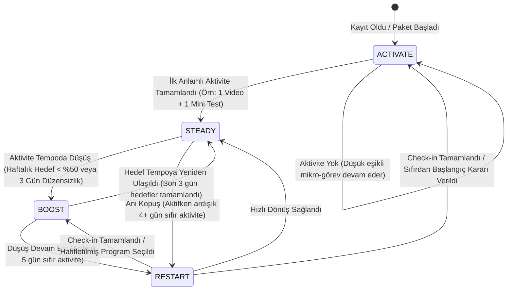
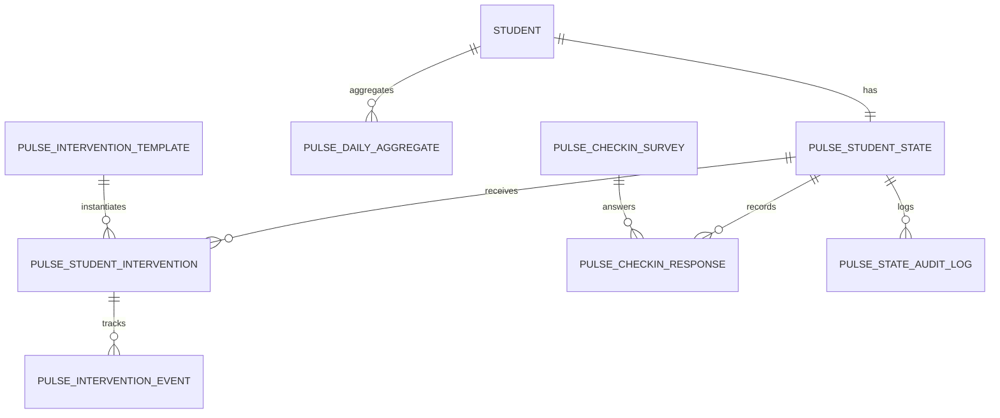
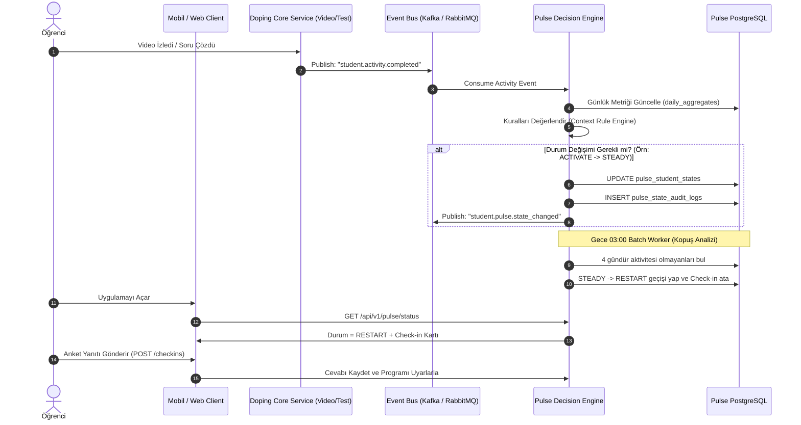

# Doping Pulse: Backend Teknik Tasarım Dokümanı (Technical Specification / RFC)

**Versiyon:** 1.0.0  
**Yazar:** Senior Backend Engineer & MT Core Team  
**Hedef Sistem:** Doping Hafıza Öğrenci Etkileşim & Müdahale Altyapısı (Pulse Engine)  
**Durum:** Draft / Review  

---

## 1. Yönetici Özeti ve Mimari Vizyon

**Doping Pulse**, öğrencinin platform içerisindeki çalışma davranışlarını, ritmini ve kopuş sinyallerini gerçek zamanlı ve kümülatif olarak analiz eden; öğrencinin ihtiyacına göre doğru anda nokta atışı müdahale (intervention) sağlayan bir **Akıllı Durum ve Karar Motorudur (State & Decision Engine)**.

### Temel Durumlar (Pulse States)
1. **🟢 ACTIVATE (Harekete Geçir):** Henüz anlamlı bir çalışma davranışı göstermemiş veya sisteme yeni adapte olan öğrenci. Eşik: Çok düşük, mikrogörev odaklı ("Bugün sadece 1 video izle").
2. **🟡 BOOST (Ritmini Güçlendir):** Çalışmaya devam eden ancak temposu düzensiz veya hedeflerinin altında kalan öğrenci. Eşik: Program hafifletme, motivasyon ve ritim adaptasyonu.
3. **🔴 RESTART (Yeniden Başlat):** Aktif çalışırken ani/kademeli kopuş yaşayan öğrenci. Eşik: Yargılamayan check-in ("Neden koptun?"), kök neden tespiti ve kişiselleştirilmiş geri dönüş planı.
4. **⚪ STEADY (Dengede / On-Track):** Hedeflediği tempoda stabil ilerleyen öğrenci. Pasif izleme durumundadır, arayüzü gereksiz bildirimle boğmaz.

---

## 2. Durum Makinesi ve Karar Motoru (State Machine & Rules)

Karar motoru iki kaynaktan beslenir:
1. **Asenkron Olaylar (Event-Driven):** Video izleme, soru çözme, deneme sınavı bitirme anında tetiklenen olaylar.
2. **Periyodik Tarama (Scheduled Batch Worker):** Her gece çalışan ve hareketsizlik/kopuş sürelerini denetleyen tarama servisi.



### Karar Kuralları ve Eşik Değerleri (Rule Matrix)

| Hedef Durum | Tetikleyici Sinyal (Signal) | Eşik Değer (Threshold) | Örnek Müdahale (Intervention) |
| :--- | :--- | :--- | :--- |
| **ACTIVATE** | Kayıt/Giriş var, aktivite yok | Son 48 saatte izlenen video $\le 0$ AND çözülen soru $\le 0$ | "Bugün sadece 5 dakikalık konuya giriş videosunu izle." (Micro-Task) |
| **BOOST** | Düşük / Düzensiz tempo | Son 7 günde hedef tamamlama oranı $<\%50$ OR son 4 günde 2+ gün boşluk | "Haftalık hedefini 20 sorudan 10 soruya düşürdük, ritmini koru." |
| **RESTART** | Aktif profilden ani kopuş | Önceki 14 günde günlük ortalama $\ge 30\text{ dk}$, son 4 günde $0\text{ dk}$ | 2 soruluk Mini Check-in: "Seni ne zorladı? (Okul sınavları / Konuyu anlamadım / Yoruldum)" |
| **STEADY** | Düzenli çalışma | Hedef tamamlama oranı $\ge \%70$ | Müdahale yok; tebrik/seri (streak) sayacı gösterimi. |

---

## 3. Veritabanı Şeması (Database Schema - PostgreSQL DDL)

Sistem ilişkisel bir veritabanı (RDBMS - PostgreSQL) üzerinde tasarlanmıştır.



### 3.1. `pulse_student_states`
Öğrencinin anlık nabız durumunu tutan ana tablo.

```sql
CREATE TYPE pulse_state_enum AS ENUM ('ACTIVATE', 'BOOST', 'RESTART', 'STEADY');

CREATE TABLE pulse_student_states (
    student_id          UUID PRIMARY KEY,
    current_state       pulse_state_enum NOT NULL DEFAULT 'ACTIVATE',
    previous_state      pulse_state_enum NULL,
    state_reason        VARCHAR(255) NOT NULL, -- Örn: 'INACTIVITY_4_DAYS', 'NEW_ENROLLMENT'
    state_updated_at    TIMESTAMP WITH TIME ZONE NOT NULL DEFAULT NOW(),
    active_intervention_id UUID NULL,          -- Aktif olarak öğrencinin ekranındaki müdahale
    consecutive_inactive_days INT NOT NULL DEFAULT 0,
    created_at          TIMESTAMP WITH TIME ZONE NOT NULL DEFAULT NOW(),
    updated_at          TIMESTAMP WITH TIME ZONE NOT NULL DEFAULT NOW()
);

CREATE INDEX idx_pulse_student_states_current ON pulse_student_states (current_state);
```

### 3.2. `pulse_daily_aggregates`
Karar motorunun öğrencileri hızlı değerlendirebilmesi için gece derlenen (veya streaming aggregate) günlük çalışma metrikleri.

```sql
CREATE TABLE pulse_daily_aggregates (
    id                  BIGSERIAL PRIMARY KEY,
    student_id          UUID NOT NULL,
    metric_date         DATE NOT NULL,
    video_watch_seconds INT NOT NULL DEFAULT 0,
    questions_solved    INT NOT NULL DEFAULT 0,
    questions_correct   INT NOT NULL DEFAULT 0,
    target_tasks_count  INT NOT NULL DEFAULT 0,
    completed_tasks_count INT NOT NULL DEFAULT 0,
    app_open_count      INT NOT NULL DEFAULT 0,
    created_at          TIMESTAMP WITH TIME ZONE NOT NULL DEFAULT NOW(),
    CONSTRAINT uq_student_metric_date UNIQUE (student_id, metric_date)
);

CREATE INDEX idx_daily_aggregates_lookup ON pulse_daily_aggregates (student_id, metric_date DESC);
```

### 3.3. `pulse_intervention_templates`
Müdahale tipleri ve içerik şablonları kataloğu.

```sql
CREATE TYPE intervention_type_enum AS ENUM ('MICRO_TASK', 'GOAL_ADAPTATION', 'CHECK_IN_SURVEY', 'MOTIVATION_CARD', 'COACH_ESCALATION');

CREATE TABLE pulse_intervention_templates (
    template_id         VARCHAR(64) PRIMARY KEY, -- Örn: 'ACTIVATE_FIRST_VIDEO_5M', 'RESTART_REASON_SURVEY_V1'
    pulse_state         pulse_state_enum NOT NULL,
    intervention_type   intervention_type_enum NOT NULL,
    title_template      VARCHAR(255) NOT NULL,
    body_template       TEXT NOT NULL,
    cta_text            VARCHAR(100) NOT NULL, -- "Hemen Başla", "Durumu Paylaş"
    cta_deep_link       VARCHAR(500) NULL,     -- "doping://video/intro-101"
    config_payload      JSONB NOT NULL DEFAULT '{}'::jsonb, -- Özel parametreler (görev id, soru listesi vb.)
    is_active           BOOLEAN NOT NULL DEFAULT TRUE,
    created_at          TIMESTAMP WITH TIME ZONE NOT NULL DEFAULT NOW()
);
```

### 3.4. `pulse_student_interventions`
Öğrenciye atanmış olan somut müdahaleler ve yaşam döngüleri.

```sql
CREATE TYPE intervention_status_enum AS ENUM ('ASSIGNED', 'VIEWED', 'INTERACTED', 'COMPLETED', 'DISMISSED', 'EXPIRED');

CREATE TABLE pulse_student_interventions (
    intervention_id     UUID PRIMARY KEY DEFAULT gen_random_uuid(),
    student_id          UUID NOT NULL REFERENCES pulse_student_states(student_id) ON DELETE CASCADE,
    template_id         VARCHAR(64) NOT NULL REFERENCES pulse_intervention_templates(template_id),
    pulse_state         pulse_state_enum NOT NULL,
    status              intervention_status_enum NOT NULL DEFAULT 'ASSIGNED',
    custom_payload      JSONB NOT NULL DEFAULT '{}'::jsonb, -- Öğrenciye özel doldurulmuş içerik
    expires_at          TIMESTAMP WITH TIME ZONE NOT NULL,
    assigned_at         TIMESTAMP WITH TIME ZONE NOT NULL DEFAULT NOW(),
    completed_at        TIMESTAMP WITH TIME ZONE NULL
);

CREATE INDEX idx_student_interventions_active ON pulse_student_interventions (student_id, status);
```

### 3.5. `pulse_intervention_events`
Öğrencinin müdahaleye verdiği reaksiyonların analitiği (Telemetry / Audit).

```sql
CREATE TABLE pulse_intervention_events (
    event_id            BIGSERIAL PRIMARY KEY,
    intervention_id     UUID NOT NULL REFERENCES pulse_student_interventions(intervention_id) ON DELETE CASCADE,
    student_id          UUID NOT NULL,
    event_type          VARCHAR(50) NOT NULL, -- 'IMPRESSION', 'CLICK_CTA', 'DISMISS', 'COMPLETE'
    metadata            JSONB NULL,
    created_at          TIMESTAMP WITH TIME ZONE NOT NULL DEFAULT NOW()
);
```

### 3.6. `pulse_checkin_surveys` & `pulse_checkin_responses`
ReStart ve kopuş durumunda kullanılan hızlı anket sistemi.

```sql
CREATE TABLE pulse_checkin_surveys (
    survey_id           VARCHAR(64) PRIMARY KEY, -- 'RESTART_DEFAULT_V1'
    title               VARCHAR(255) NOT NULL,
    question_text       VARCHAR(500) NOT NULL,
    options             JSONB NOT NULL, -- [{"key": "SCHOOL_EXAMS", "label": "Okul sınavlarım yoğundu"}, ...]
    is_active           BOOLEAN NOT NULL DEFAULT TRUE
);

CREATE TABLE pulse_checkin_responses (
    response_id         UUID PRIMARY KEY DEFAULT gen_random_uuid(),
    student_id          UUID NOT NULL REFERENCES pulse_student_states(student_id),
    intervention_id     UUID NOT NULL REFERENCES pulse_student_interventions(intervention_id),
    survey_id           VARCHAR(64) NOT NULL REFERENCES pulse_checkin_surveys(survey_id),
    selected_reason     VARCHAR(100) NOT NULL, -- 'SCHOOL_EXAMS', 'SUBJECT_DIFFICULT', 'BURNOUT', 'OTHER'
    student_note        TEXT NULL,
    applied_action      VARCHAR(100) NULL, -- Sistemin ankete cevaben yaptığı eylem: 'GOAL_HALVED', 'ROUTINE_RESET'
    created_at          TIMESTAMP WITH TIME ZONE NOT NULL DEFAULT NOW()
);

CREATE INDEX idx_checkin_reason ON pulse_checkin_responses (selected_reason);
```

### 3.7. `pulse_state_audit_logs`
Öğrencinin durum geçmişi (Hangi tarihte neden ReStart'a girdi, ne zaman Boost'a geçti?).

```sql
CREATE TABLE pulse_state_audit_logs (
    log_id              BIGSERIAL PRIMARY KEY,
    student_id          UUID NOT NULL,
    from_state          pulse_state_enum NULL,
    to_state            pulse_state_enum NOT NULL,
    transition_trigger  VARCHAR(100) NOT NULL, -- 'NIGHTLY_INACTIVITY_JOB', 'EVENT_WATCH_COMPLETED'
    trigger_context     JSONB NULL,
    created_at          TIMESTAMP WITH TIME ZONE NOT NULL DEFAULT NOW()
);

CREATE INDEX idx_pulse_audit_student ON pulse_state_audit_logs (student_id, created_at DESC);
```

---

## 4. Obje Modelleri (Domain Objects & Data Transfer Objects)

### 4.1. `StudentPulseSummaryDTO` (Mobil / Web Ana Ekrana Dönen Obje)
```typescript
interface StudentPulseSummaryDTO {
  studentId: string;
  pulseState: 'ACTIVATE' | 'BOOST' | 'RESTART' | 'STEADY';
  streakDays: number;
  activeIntervention: InterventionCardDTO | null;
}

interface InterventionCardDTO {
  interventionId: string;
  type: 'MICRO_TASK' | 'GOAL_ADAPTATION' | 'CHECK_IN_SURVEY' | 'MOTIVATION_CARD';
  badgeTitle: string;       // Örn: "Günün Kolay Adımı" veya "Hızlı Check-in"
  title: string;            // Örn: "Bugün Sadece 1 Konu Özeti"
  description: string;      // Örn: "5 dakikanı ayır, seriyi bozmadan devam et."
  cta: {
    text: string;           // "Başla (5 dk)"
    actionType: 'DEEP_LINK' | 'OPEN_SURVEY' | 'ACCEPT_ADAPTATION';
    targetPayload: string;  // "doping://content/video/12345" veya surveyId
  };
  expiresAt: string;        // ISO-8601
}
```

### 4.2. `CheckInSurveySubmissionDTO` (ReStart Anketi Yanıtı)
```typescript
interface CheckInSurveySubmissionDTO {
  interventionId: string;
  surveyId: string;
  selectedReason: 'SCHOOL_EXAMS' | 'ACADEMIC_DIFFICULTY' | 'TIRED_OR_BURNOUT' | 'TECHNICAL_ISSUE' | 'OTHER';
  freeTextNote?: string;
  requestedAction?: 'REDUCE_LOAD_50_PERCENT' | 'POSTPONE_3_DAYS' | 'RESTART_TOPIC';
}
```

### 4.3. `PulseEvaluationContext` (Karar Motoruna Giren Dahili Veri Objesi)
```typescript
interface PulseEvaluationContext {
  studentId: string;
  currentState: 'ACTIVATE' | 'BOOST' | 'RESTART' | 'STEADY';
  daysSinceEnrollment: number;
  consecutiveInactiveDays: number;
  last7DaysStats: {
    totalWatchDurationMinutes: number;
    totalQuestionsSolved: number;
    targetCompletionRatePercentage: number;
    activeDaysCount: number;
  };
  last30DaysDailyAverageMinutes: number;
}
```

---

## 5. API Dokümantasyonu (RESTful Interface Specification)

### 5.1. Client-Facing APIs (Öğrenci Mobil & Web Arayüzü)

#### `GET /api/v1/pulse/status`
Mobil uygulama ana sayfası açıldığında öğrencinin nabız durumunu ve gösterilmesi gereken müdahale kartını döner.

* **Headers:** `Authorization: Bearer <jwt_token>`
* **HTTP 200 OK Response:**
```json
{
  "studentId": "c3a1b8d2-45e0-4789-9a21-998877665544",
  "pulseState": "ACTIVATE",
  "streakDays": 0,
  "activeIntervention": {
    "interventionId": "8f7b3c2a-1122-3344-5566-778899aabbcc",
    "type": "MICRO_TASK",
    "badgeTitle": "İlk Adım",
    "title": "Bugün sadece bu 4 dakikalık videoyu izle",
    "description": "Programın gözünde büyümesine gerek yok. Sadece bir başlangıç yapıyoruz.",
    "cta": {
      "text": "Videoya Git (4 Dk)",
      "actionType": "DEEP_LINK",
      "targetPayload": "doping://lesson/matematik/temel-kavramlar-giris"
    },
    "expiresAt": "2026-10-14T23:59:59Z"
  }
}
```

---

#### `POST /api/v1/pulse/interventions/{id}/events`
Öğrencinin müdahale kartı üzerindeki etkileşimlerini loglar ve durumu günceller.

* **Path Parameter:** `id` (UUID - Intervention ID)
* **Request Body:**
```json
{
  "eventType": "CLICK_CTA", 
  "metadata": {
    "screen": "HOME_FEED",
    "timestamp": "2026-10-13T12:45:00Z"
  }
}
```
* **Event Tipleri:**
  * `IMPRESSION`: Kart ekranda görüntülendi.
  * `CLICK_CTA`: Aksiyon butonuna tıklandı.
  * `DISMISSED`: Öğrenci kartı kapattı / gizledi.
  * `COMPLETED`: Hedef mikrogörev başarıyla tamamlandı.
* **HTTP 204 No Content**

---

#### `POST /api/v1/pulse/checkins`
ReStart aşamasındaki öğrencinin mini anket yanıtını kaydeder ve buna göre aksiyon planı döndürür.

* **Request Body:**
```json
{
  "interventionId": "9e1c2b3a-4455-6677-8899-aabbccddeeff",
  "surveyId": "RESTART_DEFAULT_V1",
  "selectedReason": "SCHOOL_EXAMS",
  "freeTextNote": "Yazılı haftasındaydım, sisteme bakamadım.",
  "requestedAction": "REDUCE_LOAD_50_PERCENT"
}
```
* **HTTP 200 OK Response:**
```json
{
  "success": true,
  "message": "Harika, seni anlıyoruz! Çalışma programını sınav haftana uygun şekilde 1 hafta boyunca %50 hafiflettik.",
  "newPulseState": "BOOST",
  "adaptedPlan": {
    "dailyTargetQuestion": 10,
    "dailyTargetVideoCount": 1,
    "validUntil": "2026-10-20T23:59:59Z"
  }
}
```

---

### 5.2. Internal / Backend Engine APIs (Dahili Servisler & Cron Workers)

#### `POST /api/v1/internal/pulse/evaluate/{studentId}`
Belirli bir öğrenci için karar motorunu manuel veya olay bazlı tetikler.

* **Headers:** `X-Internal-Service-Key: <secret>`
* **Request Body:**
```json
{
  "triggerEvent": "VIDEO_COMPLETED",
  "eventPayload": {
    "lessonId": "matematik-101",
    "durationSeconds": 360
  }
}
```
* **HTTP 200 OK Response:**
```json
{
  "studentId": "c3a1b8d2-45e0-4789-9a21-998877665544",
  "transitionOccurred": true,
  "previousState": "ACTIVATE",
  "newState": "STEADY",
  "reason": "FIRST_MEANINGFUL_MILESTONE_ACHIEVED",
  "assignedInterventionId": null
}
```

---

#### `POST /api/v1/internal/pulse/batch-nightly-evaluation`
Her gece 03:00'te çalışarak hareketsizlik günlerini hesaplayan ve `BOOST`/`RESTART` geçişlerini yapan asenkron iş parçacığı.

* **Request Body:**
```json
{
  "batchDate": "2026-10-13",
  "chunkSize": 500
}
```
* **HTTP 202 Accepted Response:**
```json
{
  "jobId": "job_pulse_eval_20261013_0300",
  "status": "PROCESSING",
  "message": "Toplu değerlendirme arka planda başlatıldı."
}
```

---

## 6. Sistem Entegrasyonu ve Olay Akışı (Event-Driven Architecture)

Doping Hafıza'nın ana monolit/mikroservis mimarisini yormamak için **Olay Güdümlü (Event-Driven)** yaklaşım benimsenmiştir:



---

## 7. Mentor Sunumu İçin Önemli Teknik Notlar (Senior Perspektifi)

1. **Ölçeklenebilirlik (Scalability):** Yüzbinlerce aktif öğrencinin her aksiyonunda tüm durum geçmişini hesaplamak yerine, veriler `pulse_daily_aggregates` tablosunda kümülatif tutulur. Karar motoru sadece son 7-14 günlük özet veri penceresine (Sliding Window) bakar.
2. **Graceful Intervention (Kullanıcıyı Boğmama Kuralı):** Bir öğrenciye günde en fazla **1 aktif müdahale** atanır. Öğrenci müdahaleyi reddederse (dismiss), aynı gün tekrar kart çıkarılmaz.
3. **Auditability (İzlenebilirlik):** `pulse_state_audit_logs` tablosu sayesinde "Bu öğrenci neden ReStart'a düştü, hangi kural tetiklendi?" sorusuna geriye dönük kesin cevap verilebilir.
4. **Genişletilebilirlik (Extensibility):** `pulse_intervention_templates` tablosundaki `config_payload` alanı JSONB tutulduğu için, yeni bir müdahale tipi (örneğin "Yapay Zeka Çalışma Asistanı Sohbeti") eklenirken veritabanında migration yapmaya gerek kalmaz.

