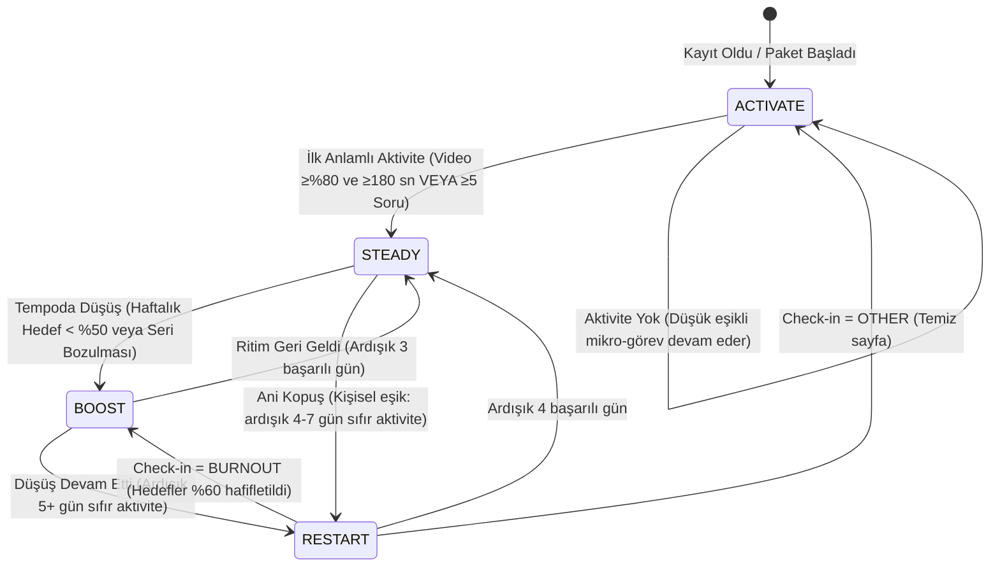
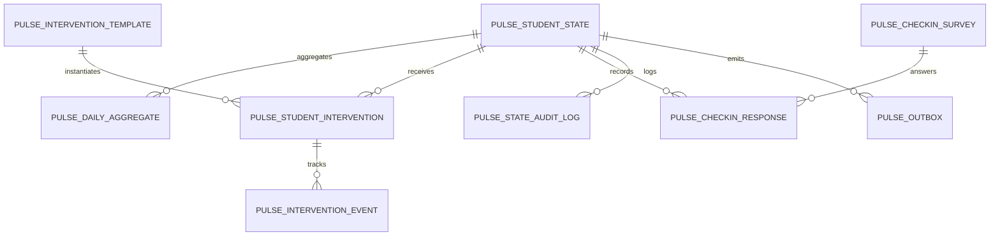
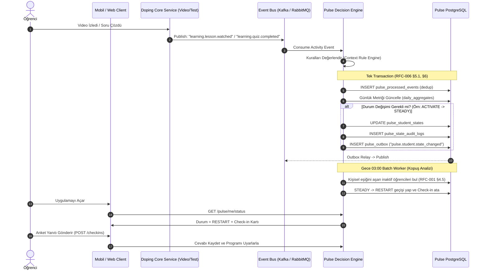

# Doping Pulse: Backend Teknik Tasarım Dokümanı (Technical Specification / RFC)

**Versiyon:** 1.0.0  
**Yazar:** Hamza Kar  
**Hedef Sistem:** Doping Hafıza Öğrenci Etkileşim & Müdahale Altyapısı (Pulse Engine)  
**Durum:** Draft / Review  

> **Normatif Kaynak Kuralı:** Bu doküman Pulse'ın çatı özetidir. Kural eşikleri, DDL, API ve olay sözleşmeleri için **normatif (bağlayıcı) kaynak ilgili RFC'dir**: durum kuralları RFC-001, veritabanı RFC-002, API RFC-003 ve OpenAPI, müdahale ve anket RFC-004, mesajlaşma RFC-006. Bir çelişki görülürse RFC geçerlidir.

---

## 1. Yönetici Özeti ve Mimari Vizyon

**Doping Pulse**, öğrencinin platform içerisindeki çalışma davranışlarını, ritmini ve kopuş sinyallerini gerçek zamanlı ve kümülatif olarak analiz eden; öğrencinin ihtiyacına göre doğru anda nokta atışı müdahale (intervention) sağlayan bir **Akıllı Durum ve Karar Motorudur (State & Decision Engine)**.

### Temel Durumlar (Pulse States)
1. **🟢 ACTIVATE (Harekete Geçir):** Henüz anlamlı bir çalışma davranışı göstermemiş veya sisteme yeni adapte olan öğrenci. Eşik: Çok düşük, mikrogörev odaklı ("Bugün sadece 1 video izle").
2. **🟡 BOOST (Ritmini Güçlendir):** Çalışmaya devam eden ancak temposu düzensiz veya hedeflerinin altında kalan öğrenci. Eşik: Program hafifletme, motivasyon ve ritim adaptasyonu.
3. **🔴 RESTART (Yeniden Başlat):** Aktif çalışırken ani/kademeli kopuş yaşayan öğrenci. Eşik: Yargılamayan check-in ("Neden koptun?"), kök neden tespiti ve kişiselleştirilmiş geri dönüş planı.
4. **⚪ STEADY (Dengede / On-Track):** Hedeflediği tempoda stabil ilerleyen öğrenci. Pasif izleme durumundadır, arayüzü gereksiz bildirimle boğmaz.

---

## 2. Durum Makinesi ve Karar Motoru (State Machine & Rules)

Karar motoru iki kaynaktan beslenir:
1. **Asenkron Olaylar (Event-Driven):** Video izleme, soru çözme, deneme sınavı bitirme anında tetiklenen olaylar.
2. **Periyodik Tarama (Scheduled Batch Worker):** Her gece çalışan ve hareketsizlik/kopuş sürelerini denetleyen tarama servisi.



### Karar Kuralları ve Eşik Değerleri (Rule Matrix)

| Hedef Durum | Tetikleyici Sinyal (Signal) | Eşik Değer (Threshold) | Örnek Müdahale (Intervention) |
| :--- | :--- | :--- | :--- |
| **ACTIVATE** | Kayıt var, henüz "Aha! Moment" yok | Video $\ge \%80$ ve $\ge 180\text{ sn}$ izlenmedi AND kümülatif $< 5$ soru | "Bugün sadece 5 dakikalık konuya giriş videosunu izle." (Micro-Task) |
| **BOOST** | Düşük / Düzensiz tempo | Son 7 günde efektif hedef tamamlama $<\%50$ OR Seri Bozulması (önceki 10 günde $\ge 6$ aktif gün + ardışık 2 gün inaktif) | "Bugünkü hedefini 20 sorudan 12 soruya düşürdük, ritmini koru." ($\%40$ hafifletme) |
| **RESTART** | Kişisel normale göre ani kopuş | Kopuş öncesi 14 günde $\ge 4$ aktif gün ve ort. $\ge 10\text{ dk/gün}$ AND ardışık inaktif gün $\ge$ kişisel eşik (4–7 gün, RFC-001 §4.5) | 2 soruluk Mini Check-in: "Seni ne zorladı? (Okul sınavları / Konuyu anlamadım / Yoruldum / Teknik sorun / Diğer)" |
| **STEADY** | Düzenli çalışma | Hedef tamamlama oranı $\ge \%70$ | Müdahale yok; tebrik/seri (streak) sayacı gösterimi. |

---

## 3. Veritabanı Şeması (Database Schema)

Pulse veri katmanı PostgreSQL 16+ üzerinde tasarlanmıştır. Üretim DDL'i, indeks stratejisi, bölümleme ve eşzamanlılık kuralları için **normatif kaynak [RFC-002: Veritabanı Şeması ve İndeksleme](database-schema-and-indexing.md)** dokümanıdır. Bu bölüm yalnızca genel bir bakış sunar.



| Tablo | Sorumluluk | Kilit Tasarım Kararları | Detay |
| :--- | :--- | :--- | :--- |
| `pulse_student_states` | Öğrencinin anlık durumu, alt durumu, aktif kartı ve dondurma/adaptasyon bilgisi | PK = `student_id`, Optimistic Locking (`version`), `experiment_arm` (holdout), `is_paused = FALSE` kısmi indeksi | RFC-002 §3.1 |
| `pulse_daily_aggregates` | Kayan pencere ve kişisel baseline hesabı için günlük çalışma özeti | Aylık Range Partitioning, PK `(metric_date, student_id)`, `(student_id, metric_date DESC)` indeksi | RFC-002 §3.2 |
| `pulse_intervention_templates` | Mikro-görev, kart ve bildirim şablon kataloğu | JSONB `config_payload` + GIN indeksi; yeni müdahale tipi migration gerektirmez | RFC-002 §3.3 |
| `pulse_student_interventions` | Öğrenciye atanan kartın yaşam döngüsü | UUIDv7 PK, `status IN ('ASSIGNED','VIEWED')` kısmi indeksi (mobil ana ekran < 5 ms) | RFC-002 §3.4 |
| `pulse_intervention_events` | Kart telemetrisi (impression, click, dismiss, complete) | Aylık Range Partitioning, yüksek yazma hacmi | RFC-002 §3.5 |
| `pulse_checkin_surveys` / `pulse_checkin_responses` | ReStart anket tanımı ve yanıtları | Versiyonlu anket; seçenek enum'ları RFC-004 §4 ile aynı | RFC-002 §3.6 |
| `pulse_state_audit_logs` | Değişmez durum geçiş izi ("neden RESTART'a düştü?") | Append-only; `metrics_snapshot` JSONB ile karar anındaki metrikler saklanır | RFC-002 §3.7 |
| `pulse_outbox` | Çıkış olaylarının iş verisiyle aynı transaction'da yazılması | Transactional Outbox, `published_at IS NULL` kısmi indeksi | RFC-002 §3.8 |
| `pulse_processed_events` | İdempotent tüketici (dedup) kaydı | Günlük bölümleme, 14 gün saklama, `event_date` bölüm anahtarı | RFC-002 §3.9 |

**Ortak Prensipler:** Birincil anahtarlarda zaman sıralı UUIDv7 kullanılır (B-tree parçalanmasını önler). Hızla büyüyen tablolar Range Partitioning ile bölümlenir. Sıcak sorgular kısmi indekslerle karşılanır. Eşzamanlılık Optimistic Locking ve `FOR UPDATE SKIP LOCKED` ile yönetilir (RFC-002 §5).

---

## 4. Obje Modelleri (Domain Objects & Data Transfer Objects)

> **Kaynak Kuralı:** İstemciye dönen DTO'ların normatif tanımı [OpenAPI sözleşmesidir](openapi-swagger-spec.yaml) (`components/schemas`). Dahili motor objeleri (§4.3, §4.4) RFC-001 §6'daki pseudo-code ile birebir eşleşir. TypeScript'te `camelCase`, pseudo-code ve DB'de `snake_case` kullanılır.

```typescript
type PulseState = 'ACTIVATE' | 'BOOST' | 'RESTART' | 'STEADY';
type PulseSubState =
  | 'ACTIVATE_ONBOARDING' | 'ACTIVATE_STALLED' | 'ACTIVATE_CRITICAL'
  | 'BOOST_STREAK_BROKEN' | 'BOOST_LOW_PACE' | 'BOOST_BURNOUT_RISK'
  | 'RESTART_CHECKIN_PENDING' | 'RESTART_ADAPTED' | 'RESTART_UNRESPONSIVE'
  | 'STEADY_NORMAL' | 'STEADY_STREAK_HERO';
```

### 4.1. `StudentPulseSummaryDTO` (Mobil / Web Ana Ekrana Dönen Obje)
```typescript
interface StudentPulseSummaryDTO {
  studentId: string;
  pulseState: PulseState;
  pulseSubState: PulseSubState;
  consecutiveInactiveDays: number;
  streakDays: number;
  isPaused: boolean;
  activeIntervention: InterventionCardDTO | null;   // Günde en fazla 1 aktif kart (RFC-004 §5.1)
}

interface InterventionCardDTO {
  interventionId: string;   // UUIDv7
  templateId: string;       // Örn: "ACTIVATE_FIRST_5M_VIDEO"
  type: 'MICRO_TASK' | 'GOAL_ADAPTATION' | 'CHECK_IN_SURVEY' | 'MOTIVATION_CARD';
  badgeText: string;        // Örn: "Günün Kolay Adımı" veya "Hızlı Check-in"
  title: string;            // Örn: "Bugün sadece bu 4 dakikalık videoyu izle"
  description: string;      // Örn: "Programın gözünde büyümesine gerek yok."
  cta: {
    text: string;           // "Videoya Git (4 Dk)"
    actionType: 'DEEP_LINK' | 'MODAL_SURVEY' | 'MUTATION';
    payload: string;        // "doping://content/lesson/mat-temel-kavramlar" veya surveyId
  };
  dismissible: boolean;     // Varsayılan: true
  expiresAt: string;        // ISO-8601, en fazla 24 saat (RFC-004 §5.1)
}
```

### 4.2. `CheckInSurveySubmissionDTO` (ReStart Anketi Yanıtı)
```typescript
interface CheckInSurveySubmissionDTO {
  interventionId: string;
  surveyId: string;
  selectedReason: 'SCHOOL_EXAMS' | 'SUBJECT_DIFFICULTY' | 'BURNOUT' | 'TECHNICAL_ISSUE' | 'OTHER';
  freeTextNote?: string;
  // Eylem istemciden gelmez; selectedReason'dan sunucuda türetilir (RFC-004 §4)
}
```

### 4.3. `PulseEvaluationContext` (Karar Motoruna Giren Dahili Veri Objesi)
Motor her değerlendirmede bu objeyi `pulse_student_states` ve `pulse_daily_aggregates` (son 21 gün) üzerinden tek seferde oluşturur. Değerlendirme fonksiyonu yalnızca bu objeyi okur; DB'ye tekrar gitmez, bu da onu saf (pure) ve test edilebilir kılar.

```typescript
interface PulseEvaluationContext {
  studentId: string;

  // --- Mevcut durum (pulse_student_states) ---
  currentState: PulseState;
  currentSubState: PulseSubState;
  stateUpdatedAt: string;               // Cooldown hesabı (48 saat)
  isPaused: boolean;
  pausedUntil: string | null;
  adaptationExpiresAt: string | null;   // RESTART_ADAPTED / BOOST_BURNOUT_RISK bitişi
  experimentArm: 'TREATMENT' | 'HOLDOUT'; // Motor okumaz; Müdahale Motoru okur (RFC-004 §1)
  version: number;                      // Optimistic Locking için beklenen sürüm

  // --- ACTIVATE / Aha! Moment (RFC-001 §4.1) ---
  daysSinceEnrollment: number;
  lifetimeActiveSeconds: number;
  lifetimeQuestionsSolved: number;
  bestLessonCompletionPct: number;      // Tek bir videoda ulaşılan en yüksek izleme yüzdesi
  bestLessonWatchedSeconds: number;     // O videoda izlenen saniye

  // --- Tempo metrikleri (efektif/hafifletilmiş hedefe göre, RFC-001 §4.2) ---
  consecutiveInactiveDays: number;
  last7dEffectiveCompletionRate: number; // WCR, 0.0 - 1.0
  consecutiveSuccessfulDays: number;     // Efektif hedefin >= %80'i tamamlanan ardışık gün
  streakBrokenRecently: boolean;         // Önceki 10 günde >= 6 aktif gün + ardışık 2 gün inaktif

  // --- Kişisel baseline (RFC-001 §4.5) ---
  anchoredBaseline: AnchoredBaseline;
}

interface AnchoredBaseline {
  windowStart: string;                  // ISO tarih: streak_start - 14 gün
  windowEnd: string;                    // ISO tarih: streak_start - 1 gün
  activeDays: number;                   // Eşik: >= 4
  avgMinutes: number;                   // Eşik: >= 10 dk/gün (14 güne bölünür)
  maxGapDays: number;                   // Penceredeki en uzun inaktif seri
  restartThresholdDays: number;         // clamp(maxGapDays + 2, 4, 7)
}
```

### 4.4. `PulseEvaluationResult` (Karar Motorunun Çıktısı)
```typescript
interface PulseEvaluationResult {
  transitionOccurred: boolean;          // false ise diğer alanlar null (no_change)
  previousState: PulseState | null;
  previousSubState: PulseSubState | null;
  newState: PulseState | null;
  newSubState: PulseSubState | null;
  reason: string | null;                // Örn: "INACTIVE_4D_PERSONAL_THRESHOLD_4D"
  cooldownUntil: string | null;         // RESTART girişinde cooldown delinir ama yeni cooldown başlar
  metricsSnapshot: Record<string, unknown>; // pulse_state_audit_logs.metrics_snapshot'a yazılır
}
```
Bir geçiş gerçekleştiğinde bu sonuç tek bir transaction içinde şu kayıtlara dönüşür: `pulse_student_states` güncellemesi, `pulse_state_audit_logs` satırı ve `pulse_outbox` olayı. Değerlendirme bir Kafka olayıyla tetiklendiyse aynı transaction'a dedup kaydı da eklenir (RFC-006 §5.1).

---

## 5. API Dokümantasyonu (RESTful Interface Specification)

> Base URL: `https://api.dopinghafiza.com/pulse/v1`. Tüm uç noktaların normatif tanımı, hata kodları ve `Idempotency-Key` kuralları için [RFC-003](api-specification.md) ve [OpenAPI](openapi-swagger-spec.yaml) dokümanlarına bakılır.

### 5.1. Client-Facing APIs (Öğrenci Mobil & Web Arayüzü)

#### `GET /pulse/me/status`
Mobil uygulama ana sayfası açıldığında öğrencinin nabız durumunu ve gösterilmesi gereken müdahale kartını döner.

* **Headers:** `Authorization: Bearer <jwt_token>`
* **HTTP 200 OK Response:**
```json
{
  "studentId": "c3a1b8d2-45e0-4789-9a21-998877665544",
  "pulseState": "ACTIVATE",
  "streakDays": 0,
  "activeIntervention": {
    "interventionId": "8f7b3c2a-1122-3344-5566-778899aabbcc",
    "type": "MICRO_TASK",
    "badgeTitle": "İlk Adım",
    "title": "Bugün sadece bu 4 dakikalık videoyu izle",
    "description": "Programın gözünde büyümesine gerek yok. Sadece bir başlangıç yapıyoruz.",
    "cta": {
      "text": "Videoya Git (4 Dk)",
      "actionType": "DEEP_LINK",
      "targetPayload": "doping://lesson/matematik/temel-kavramlar-giris"
    },
    "expiresAt": "2026-10-14T23:59:59Z"
  }
}
```

---

#### `POST /pulse/interventions/{interventionId}/events`
Öğrencinin müdahale kartı üzerindeki etkileşimlerini loglar ve durumu günceller.

* **Path Parameter:** `id` (UUID - Intervention ID)
* **Request Body:**
```json
{
  "eventType": "CLICK_CTA", 
  "metadata": {
    "screen": "HOME_FEED",
    "timestamp": "2026-10-13T12:45:00Z"
  }
}
```
* **Event Tipleri:**
  * `IMPRESSION`: Kart ekranda görüntülendi.
  * `CLICK_CTA`: Aksiyon butonuna tıklandı.
  * `DISMISSED`: Öğrenci kartı kapattı / gizledi.
  * `COMPLETED`: Hedef mikrogörev başarıyla tamamlandı.
* **HTTP 204 No Content**

---

#### `POST /pulse/checkins`
ReStart aşamasındaki öğrencinin mini anket yanıtını kaydeder ve buna göre aksiyon planı döndürür.

* **Request Body:**
```json
{
  "interventionId": "9e1c2b3a-4455-6677-8899-aabbccddeeff",
  "surveyId": "RESTART_DEFAULT_V1",
  "selectedReason": "SCHOOL_EXAMS",
  "freeTextNote": "Yazılı haftasındaydım, sisteme bakamadım."
}
```
* **HTTP 200 OK Response:**
```json
{
  "success": true,
  "message": "Sınav haftanı biliyoruz! Doping hedeflerini 7 gün dondurduk, sınavlarına odaklan.",
  "newPulseState": "RESTART",
  "newPulseSubState": "RESTART_ADAPTED",
  "adaptedPlan": {
    "actionType": "ACTION_FREEZE_GOALS",
    "dailyTargetQuestion": 0,
    "dailyTargetVideoCount": 0,
    "validUntil": "2026-10-20T23:59:59Z"
  }
}
```

---

### 5.2. Internal / Backend Engine APIs (Dahili Servisler & Cron Workers)

#### `POST /internal/pulse/evaluate/{studentId}`
Belirli bir öğrenci için karar motorunu manuel veya olay bazlı tetikler.

* **Headers:** `X-Internal-Service-Key: <secret>`
* **Request Body:**
```json
{
  "triggerEvent": "VIDEO_COMPLETED",
  "eventPayload": {
    "lessonId": "matematik-101",
    "durationSeconds": 360
  }
}
```
* **HTTP 200 OK Response:**
```json
{
  "studentId": "c3a1b8d2-45e0-4789-9a21-998877665544",
  "transitionOccurred": true,
  "previousState": "ACTIVATE",
  "newState": "STEADY",
  "reason": "FIRST_MEANINGFUL_MILESTONE_ACHIEVED",
  "assignedInterventionId": null
}
```

---

#### `POST /internal/pulse/batch/nightly-evaluation`
Her gece 03:00'te çalışarak hareketsizlik günlerini hesaplayan ve `BOOST`/`RESTART` geçişlerini yapan asenkron iş parçacığı.

* **Request Body:**
```json
{
  "batchDate": "2026-10-13",
  "chunkSize": 500
}
```
* **HTTP 202 Accepted Response:**
```json
{
  "jobId": "job_pulse_eval_20261013_0300",
  "status": "PROCESSING",
  "message": "Toplu değerlendirme arka planda başlatıldı."
}
```

---

## 6. Sistem Entegrasyonu ve Olay Akışı (Event-Driven Architecture)

Doping Hafıza'nın ana monolit/mikroservis mimarisini yormamak için **Olay Güdümlü (Event-Driven)** yaklaşım benimsenmiştir:



---

## 7. Mimari Tasarım Prensipleri ve Karar Gerekçeleri (Architectural Design Principles)

1. **Ölçeklenebilirlik (Scalability):** Yüzbinlerce aktif öğrencinin her aksiyonunda tüm durum geçmişini hesaplamak yerine, veriler `pulse_daily_aggregates` tablosunda kümülatif tutulur. Karar motoru sadece son 7-14 günlük özet veri penceresine (Sliding Window) bakar.
2. **Graceful Intervention (Kullanıcıyı Boğmama Kuralı):** Bir öğrenciye günde en fazla **1 aktif müdahale** atanır. Öğrenci müdahaleyi reddederse (dismiss), aynı gün tekrar kart çıkarılmaz.
3. **Auditability (İzlenebilirlik):** `pulse_state_audit_logs` tablosu sayesinde "Bu öğrenci neden ReStart'a düştü, hangi kural tetiklendi?" sorusuna geriye dönük kesin cevap verilebilir.
4. **Genişletilebilirlik (Extensibility):** `pulse_intervention_templates` tablosundaki `config_payload` alanı JSONB tutulduğu için, yeni bir müdahale tipi (örneğin "Yapay Zeka Çalışma Asistanı Sohbeti") eklenirken veritabanında migration yapmaya gerek kalmaz.

