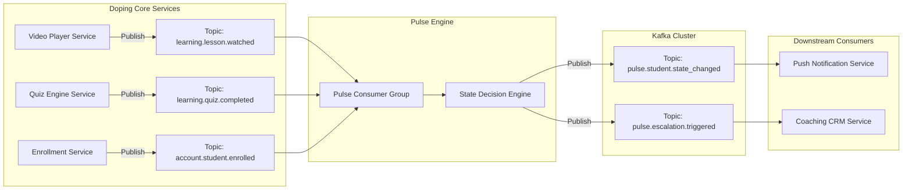
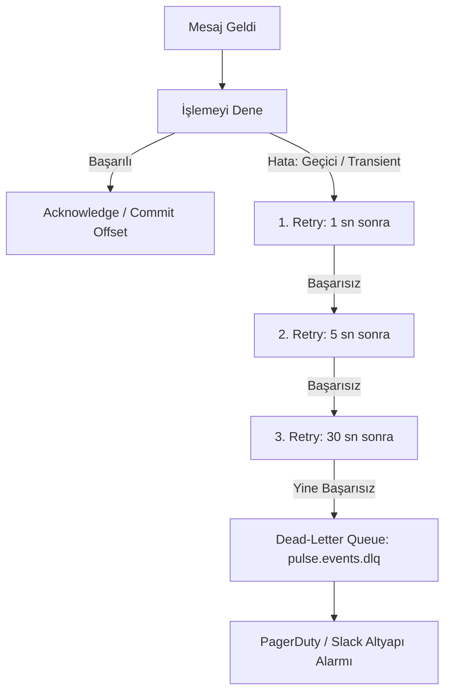

# 📨 Doping Pulse: Olay Güdümlü Mesajlaşma ve Kuyruk Mimarisi Spesifikasyonu (Event-Driven RFC)

**Doküman Kodu:** `RFC-PULSE-006`  
**Modül:** `Pulse Event Bus & Streaming Infrastructure`  
**Mimar:** Senior Backend Architect & MT Core Team  
**Kullanılan Teknoloji:** Apache Kafka / AWS MSK (Alternatif: RabbitMQ)  
**Tasarım Prensibi:** Sıfır Senkron Bağımlılık (Zero Synchronous Coupling), Kesin Sıralama (Strict Ordering per Student) ve Hata Toleransı (DLQ & Resilience).

---

## 1. Neden Event-Driven Mimari?

Doping Hafıza ekosisteminde her gün milyonlarca video izlenir ve test çözülür.  
Eğer ana video veya test servisi her aksiyonda Pulse motoruna senkron bir HTTP isteği (`POST /evaluate`) atsaydı:
1. **Gecikme Artışı (Latency Spike):** Öğrencinin video tamamlama ekranı Pulse hesaplamasını beklemek zorunda kalırdı.
2. **Kaskad Çökme (Cascading Failure):** Pulse servisi yavaşlarsa veya kesilirse, ana video oynatma altyapısı da etkilenirdi.

**Çözüm:** Core servisler sadece hafif bir olay yayınlar (**Fire-and-Forget**). Pulse motoru bu olayları arka planda asenkron olarak tüketir (Consumer).



---

## 2. Topic İsimlendirme ve Tasarım Standartları

Event isimleri kurumsal Domain-Driven Design (DDD) standardına uygundur:  
Format: `<domain>.<entity>.<past-tense-action>`

### 2.1. Pulse Tarafından Tüketilen Giriş Olayları (Ingress Topics)
| Topic Adı | Kaynak Servis | Açıklama |
| :--- | :--- | :--- |
| `learning.lesson.watched` | Video Streaming Service | Öğrenci bir videoyu bitirdiğinde veya belirli bir yüzdesini izlediğinde fırlatılır. |
| `learning.quiz.completed` | Soru Bankası Servisi | Öğrenci mini test veya deneme sınavı tamamladığında fırlatılır. |
| `account.student.enrolled` | Satış / Üyelik Servisi | Yeni paket satın alındığında `ACTIVATE` durumunu başlatmak için fırlatılır. |
| `planning.target.configured`| Çalışma Takvimi Servisi | Öğrencinin günlük/haftalık soru hedefi güncellendiğinde fırlatılır. |

### 2.2. Pulse Tarafından Üretilen Çıkış Olayları (Egress Topics)
| Topic Adı | Hedef Tüketiciler | Açıklama |
| :--- | :--- | :--- |
| `pulse.student.state_changed` | Notification Service, Analytics | Durum değiştiğinde (örn: `ACTIVATE` $\rightarrow$ `STEADY`). |
| `pulse.intervention.assigned` | Mobile Push Gateway | Öğrenciye yeni bir mikro-görev kartı çıktığında anlık bildirim fırlatır. |
| `pulse.escalation.triggered` | Coaching CRM, SMS Gateway | Veliye SMS veya koça alarm görevi oluşturulması gerektiğinde. |

---

## 3. Standart Olay Zarfı ve Şemalar (Event Schema & Envelope)

Tüm olaylar sürüm takibi ve izlenebilirlik (distributed tracing) için kurumsal bir **Event Envelope** ile sarılır:

### 3.1. Giriş Olayı: `learning.lesson.watched`
```json
{
  "eventId": "evt_018f3a2b-7c4d-7a89-9e12-3456789abcde",
  "eventType": "learning.lesson.watched",
  "schemaVersion": "1.2.0",
  "timestamp": "2026-10-13T17:40:00Z",
  "aggregateId": "c3a1b8d2-45e0-4789-9a21-998877665544", 
  "correlationId": "req_88192312-3344",
  "payload": {
    "studentId": "c3a1b8d2-45e0-4789-9a21-998877665544",
    "lessonId": "mat-fonksiyonlar-giris-01",
    "subject": "MATEMATIK",
    "durationWatchedSeconds": 320,
    "totalDurationSeconds": 360,
    "completionPercentage": 88.8,
    "isCompleted": true
  }
}
```

### 3.2. Çıkış Olayı: `pulse.student.state_changed`
```json
{
  "eventId": "evt_99182312-7c4d-7a89-9e12-998877665544",
  "eventType": "pulse.student.state_changed",
  "schemaVersion": "1.0.0",
  "timestamp": "2026-10-13T17:40:02Z",
  "aggregateId": "c3a1b8d2-45e0-4789-9a21-998877665544",
  "payload": {
    "studentId": "c3a1b8d2-45e0-4789-9a21-998877665544",
    "previousState": "ACTIVATE",
    "newState": "STEADY",
    "previousSubState": "ACTIVATE_STALLED",
    "newSubState": "STEADY_NORMAL",
    "transitionReason": "FIRST_MEANINGFUL_MILESTONE_ACHIEVED",
    "assignedInterventionId": null,
    "cooldownUntil": "2026-10-15T17:40:02Z"
  }
}
```

---

## 4. Bölümleme Anahtarı ve Kesin Sıralama Güvencesi (Partitioning Strategy)

Dağıtık sistemlerde bir öğrencinin aynı anda video izlemesi ve test bitirmesi durumunda olayların yanlış sırada işlenmesi (Out-of-order execution) durumu bozabilir.

* **Kritik Kural:** Tüm olaylarda Kafka **Partition Key = `studentId`** olarak ayarlanır.
* **Neden?** Kafka aynı partition key'e sahip tüm mesajları **aynı partition'a** yönlendirir ve o partition içinde **kesin sıra güvencesi (Strict Ordering)** sağlar. Böylece öğrencinin aksiyonları milisaniyelik hassasiyetle kronolojik sırayla işlenir.

---

## 5. Dayanıklılık, Hata Yönetimi ve Dead-Letter Queue (Resilience & DLQ)

Ağ kopması, veritabanı kilitlenmesi veya beklenmeyen bir format hatasında mesajların kaybolmaması için 3 aşamalı koruma ağı kurulur:



### 5.1. İdempotent Tüketici (Duplicate Message Deduplication)
Kafka en az bir kez teslimat (**At-least-once delivery**) garantisi sunar; bu da aynı mesajın nadiren de olsa iki kez gelebileceği anlamına gelir.  
Pulse Consumer, gelen her `eventId`'yi Redis üzerinde 24 saatlik TTL ile saklar (`SETNX pulse:events:{eventId} 1 EX 86400`). Eğer anahtar zaten varsa mesaj sessizce yutulur ve çift durum tetiklenmesi önlenir.

### 5.2. Dead-Letter Queue (DLQ)
Tüm yeniden denemeler (3x Exponential Backoff) tükendiğinde mesaj atılmaz; hata yığını (stack trace) meta-verisi eklenerek `pulse.events.dlq` topic'ine yönlendirilir. Mühendislik ekibi alarm alır ve mesaj incelendikten sonra tek tıkla yeniden işletilebilir (Re-drive).

