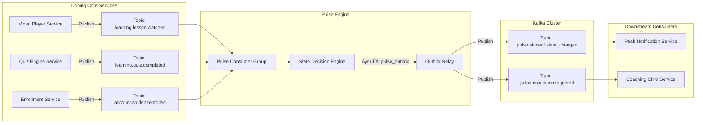
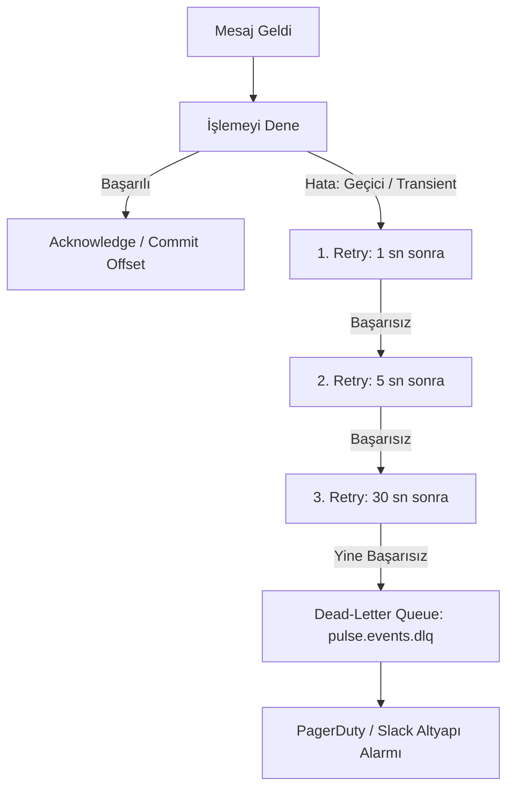
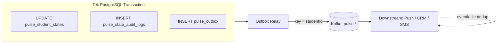

# 📨 Doping Pulse: Olay Güdümlü Mesajlaşma ve Kuyruk Mimarisi Spesifikasyonu (Event-Driven RFC)

**Doküman Kodu:** `RFC-PULSE-006`  
**Modül:** `Pulse Event Bus & Streaming Infrastructure`  
**Yazar:** Hamza Kar  
**Kullanılan Teknoloji:** Apache Kafka / AWS MSK (Alternatif: RabbitMQ)  
**Tasarım Prensibi:** Sıfır Senkron Bağımlılık (Zero Synchronous Coupling), Kesin Sıralama (Strict Ordering per Student) ve Hata Toleransı (DLQ & Resilience).

---

## 1. Neden Event-Driven Mimari?

Doping Hafıza ekosisteminde her gün milyonlarca video izlenir ve test çözülür.  
Eğer ana video veya test servisi her aksiyonda Pulse motoruna senkron bir HTTP isteği (`POST /evaluate`) atsaydı:
1. **Gecikme Artışı (Latency Spike):** Öğrencinin video tamamlama ekranı Pulse hesaplamasını beklemek zorunda kalırdı.
2. **Kaskad Çökme (Cascading Failure):** Pulse servisi yavaşlarsa veya kesilirse, ana video oynatma altyapısı da etkilenirdi.

**Çözüm:** Core servisler sadece hafif bir olay yayınlar (**Fire-and-Forget**). Pulse motoru bu olayları arka planda asenkron olarak tüketir (Consumer).



---

## 2. Topic İsimlendirme ve Tasarım Standartları

Event isimleri kurumsal Domain-Driven Design (DDD) standardına uygundur:  
Format: `<domain>.<entity>.<past-tense-action>`

### 2.1. Pulse Tarafından Tüketilen Giriş Olayları (Ingress Topics)
| Topic Adı | Kaynak Servis | Açıklama |
| :--- | :--- | :--- |
| `learning.lesson.watched` | Video Streaming Service | Öğrenci bir videoyu bitirdiğinde veya belirli bir yüzdesini izlediğinde fırlatılır. |
| `learning.quiz.completed` | Soru Bankası Servisi | Öğrenci mini test veya deneme sınavı tamamladığında fırlatılır. |
| `account.student.enrolled` | Satış / Üyelik Servisi | Yeni paket satın alındığında `ACTIVATE` durumunu başlatmak için fırlatılır. |
| `planning.target.configured`| Çalışma Takvimi Servisi | Öğrencinin günlük/haftalık soru hedefi güncellendiğinde fırlatılır. |

### 2.2. Pulse Tarafından Üretilen Çıkış Olayları (Egress Topics)
| Topic Adı | Hedef Tüketiciler | Açıklama |
| :--- | :--- | :--- |
| `pulse.student.state_changed` | Notification Service, Analytics | Durum değiştiğinde (örn: `ACTIVATE` $\rightarrow$ `STEADY`). |
| `pulse.intervention.assigned` | Mobile Push Gateway | Öğrenciye yeni bir mikro-görev kartı çıktığında anlık bildirim fırlatır. |
| `pulse.escalation.triggered` | Coaching CRM, SMS Gateway | Veliye SMS veya koça alarm görevi oluşturulması gerektiğinde. |

---

## 3. Standart Olay Zarfı ve Şemalar (Event Schema & Envelope)

Tüm olaylar sürüm takibi ve izlenebilirlik (distributed tracing) için kurumsal bir **Event Envelope** ile sarılır:

### 3.1. Giriş Olayı: `learning.lesson.watched`
```json
{
  "eventId": "evt_018f3a2b-7c4d-7a89-9e12-3456789abcde",
  "eventType": "learning.lesson.watched",
  "schemaVersion": "1.2.0",
  "timestamp": "2026-10-13T17:40:00Z",
  "aggregateId": "c3a1b8d2-45e0-4789-9a21-998877665544", 
  "correlationId": "req_88192312-3344",
  "payload": {
    "studentId": "c3a1b8d2-45e0-4789-9a21-998877665544",
    "lessonId": "mat-fonksiyonlar-giris-01",
    "subject": "MATEMATIK",
    "durationWatchedSeconds": 320,
    "totalDurationSeconds": 360,
    "completionPercentage": 88.8,
    "isCompleted": true
  }
}
```

### 3.2. Çıkış Olayı: `pulse.student.state_changed`
```json
{
  "eventId": "evt_99182312-7c4d-7a89-9e12-998877665544",
  "eventType": "pulse.student.state_changed",
  "schemaVersion": "1.0.0",
  "timestamp": "2026-10-13T17:40:02Z",
  "aggregateId": "c3a1b8d2-45e0-4789-9a21-998877665544",
  "payload": {
    "studentId": "c3a1b8d2-45e0-4789-9a21-998877665544",
    "previousState": "ACTIVATE",
    "newState": "STEADY",
    "previousSubState": "ACTIVATE_STALLED",
    "newSubState": "STEADY_NORMAL",
    "transitionReason": "FIRST_MEANINGFUL_MILESTONE_ACHIEVED",
    "assignedInterventionId": null,
    "cooldownUntil": "2026-10-15T17:40:02Z"
  }
}
```

---

## 4. Bölümleme Anahtarı ve Kesin Sıralama Güvencesi (Partitioning Strategy)

Dağıtık sistemlerde bir öğrencinin aynı anda video izlemesi ve test bitirmesi durumunda olayların yanlış sırada işlenmesi (Out-of-order execution) durumu bozabilir.

* **Kritik Kural:** Tüm olaylarda Kafka **Partition Key = `studentId`** olarak ayarlanır.
* **Neden?** Kafka aynı partition key'e sahip tüm mesajları **aynı partition'a** yönlendirir ve o partition içinde **kesin sıra güvencesi (Strict Ordering)** sağlar. Böylece öğrencinin aksiyonları milisaniyelik hassasiyetle kronolojik sırayla işlenir.

---

## 5. Dayanıklılık, Hata Yönetimi ve Dead-Letter Queue (Resilience & DLQ)

Ağ kopması, veritabanı kilitlenmesi veya beklenmeyen bir format hatasında mesajların kaybolmaması için 3 aşamalı koruma ağı kurulur:



### 5.1. İdempotent Tüketici (Duplicate Message Deduplication)
Kafka en az bir kez teslimat (**At-least-once delivery**) garantisi sunar; bu da aynı mesajın nadiren de olsa iki kez gelebileceği anlamına gelir.

**Reddedilen Yaklaşım — İşlemden Önce Redis `SETNX`:** Anahtar işlemden *önce* yazılırsa ve işlem yarıda başarısız olursa (DB timeout, pod restart), retry ile gelen aynı mesaj "zaten görüldü" sanılıp yutulur. Sonuç **sessiz veri kaybıdır**: aktivite sayılmaz ve öğrenci haksız yere RESTART'a düşebilir. Redis ile DB ayrı sistemler olduğu için ikisini atomik yapmak mümkün değildir.

**Kanonik Yaklaşım — Dedup Kaydı İş Verisiyle Aynı Transaction'da:**
```sql
BEGIN;
  -- 1. Dedup: Mesaj daha önce işlendiyse 0 satır döner -> ROLLBACK + offset commit (sessizce atla)
  INSERT INTO pulse_processed_events (event_date, consumer_group, event_id)
  VALUES (:event_timestamp::date, 'pulse-engine', :event_id)   -- DDL: RFC-002 §3.9
  ON CONFLICT DO NOTHING;

  -- 2. İş verisi: Günlük agregasyon + durum güncellemesi + audit log
  INSERT INTO pulse_daily_aggregates (...) ON CONFLICT (metric_date, student_id) DO UPDATE ...;
  UPDATE pulse_student_states SET ..., version = version + 1 WHERE student_id = :sid AND version = :v;
  INSERT INTO pulse_state_audit_logs (...);

  -- 3. Çıkış olayı: Doğrudan Kafka'ya değil, Outbox tablosuna (bkz. §6)
  INSERT INTO pulse_outbox (...);
COMMIT;
-- 4. Ancak COMMIT başarılıysa Kafka offset commit edilir.
```
* Dedup kaydı ile iş verisi birlikte commit edilir ya da birlikte geri alınır. Böylece "işlendi ama kaydedilmedi" veya "kaydedildi ama işlenmedi" ara durumu oluşamaz.
* **Saklama süresi:** `pulse_processed_events` tablosu günlük bölümlenir ve **14 gün** tutulur. Bu süre Kafka topic retention'ından (7 gün) ve DLQ re-drive penceresinden uzundur; geç yeniden işletilen bir mesaj da dedup'a takılır. Eski bölümler `DROP PARTITION` ile maliyetsiz silinir. 14 günden eski olaylar `STALE_EVENT` olarak DLQ'ya gider.
* Redis istenirse yalnızca **COMMIT sonrası** doldurulan bir hızlı yol önbelleği (fast-path cache) olarak kullanılabilir. Doğruluk garantisi her zaman DB'dedir.

### 5.1.1. Retry Sırasında Sıra Garantisi
Retry'lar (1 sn → 5 sn → 30 sn) **aynı partition üzerinde bloklayan (in-line)** şekilde yapılır; ayrı bir retry topic'ine taşınmaz. Mesaj başarıyla işlenene ya da DLQ'ya düşene kadar o partition'daki sonraki mesajlar beklediği için öğrenci bazında sıra korunur. Bunun bedeli, en kötü durumda o partition için ~36 sn gecikmedir ve bu süre SLO bütçesi içinde kalır.

Bir mesaj DLQ'ya düştükten sonra aynı öğrencinin sonraki olayları işlenmeye devam eder; yani sıra bu noktada bilinçli olarak gevşetilir. Bu güvenlidir, çünkü karar motoru olay *sırasına* değil, `pulse_daily_aggregates` üzerindeki **toplam duruma** göre karar verir (state-based, not sequence-based). DLQ'dan yeniden işletilen (re-drive) mesaj agregasyona eklenir, dedup tablosu mükerrer işlemeyi engeller ve bir sonraki değerlendirme doğru sonuca ulaşır.

### 5.2. Dead-Letter Queue (DLQ)
Tüm yeniden denemeler (3x Exponential Backoff) tükendiğinde mesaj atılmaz; hata yığını (stack trace) meta-verisi eklenerek `pulse.events.dlq` topic'ine yönlendirilir. Mühendislik ekibi alarm alır ve mesaj incelendikten sonra tek tıkla yeniden işletilebilir (Re-drive).


---

## 6. Transactional Outbox Pattern (Dual-Write Problemi)

**Problem:** Durum değişikliği PostgreSQL'e yazılırken çıkış olayı (`pulse.student.state_changed`) Kafka'ya basılır. Bunlar iki ayrı sistemdir ve ikisini tek transaction'da yapmak mümkün değildir:

| Senaryo | Sonuç |
| :--- | :--- |
| DB commit ✅ → Kafka publish ❌ (broker erişilemez, pod çöker) | Öğrenci `RESTART` oldu ama Push/CRM bundan haberdar olmadı; check-in bildirimi hiç gitmedi. |
| Kafka publish ✅ → DB commit ❌ (optimistic lock çakışması) | Downstream servisler *hiç gerçekleşmemiş* bir durum değişikliğine göre veliye SMS attı. |

**Çözüm:** Pulse motoru Kafka'ya **asla doğrudan** yazmaz. Çıkış olayları iş verisiyle **aynı transaction'da** `pulse_outbox` tablosuna yazılır (DDL: RFC-002 §3.8). Ayrı bir **Outbox Relay** süreci bu tabloyu Kafka'ya taşır.



### 6.1. Relay Seçenekleri
| Seçenek | Nasıl Çalışır | Artı | Eksi | Karar |
| :--- | :--- | :--- | :--- | :--- |
| **Polling Publisher** | Relay worker'ları `SELECT ... WHERE published_at IS NULL ORDER BY id FOR UPDATE SKIP LOCKED LIMIT 500` ile satırları alır, Kafka'ya basar ve `published_at` alanını işaretler. | Ek altyapı gerektirmez, basit ve test edilebilir. | ~100–500 ms ek gecikme, DB'ye periyodik sorgu yükü. | **MVP** |
| **CDC (Debezium)** | PostgreSQL WAL'ı okunur, outbox insert'leri Kafka'ya akıtılır (Outbox Event Router). | Gecikme <100 ms, DB'ye sorgu yükü yok. | Kafka Connect ve Debezium operasyonu, replication slot yönetimi gerekir. | **Ölçek fazı** |

### 6.2. Garantiler ve Sorumluluklar
* **At-least-once:** Relay Kafka'ya bastıktan sonra `published_at` işaretlenmeden çökerse olay ikinci kez basılır. Bu yüzden tüm downstream tüketiciler `eventId` üzerinden idempotent olmak **zorundadır** (§5.1 ile aynı desen). Bu bir sözleşme maddesidir.
* **Sıra:** Outbox `id` (UUIDv7, zaman sıralı) ve `aggregate_id` (= `studentId`) partition key'i sayesinde öğrenci bazında sıra korunur.
* **Temizlik:** `published_at` dolu satırlar 7 gün sonra bölüm bazında silinir.
* **Gözlemlenebilirlik:** `pulse_outbox_unpublished_records` (gauge) ve `pulse_outbox_oldest_unpublished_age_seconds` metrikleri izlenir. 60 sn'yi aşan yaş Sev-2 alarmıdır (RFC-007 §4.2).
