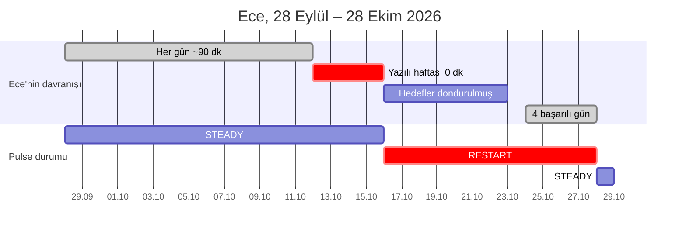

# 🧭 Doping Pulse: Uçtan Uca Örnek Senaryo, Ece'nin RESTART Yolculuğu

**Doküman Türü:** Örnek senaryo. Kuralları değil, kuralların tek bir öğrenci üzerinde nasıl çalıştığını gösterir.  
**Yazar:** Hamza Kar  
**Kullanılan kurallar:** RFC-001 (state machine, kişisel baseline), RFC-002 (tablolar), RFC-003 (API), RFC-004 (anket ve dondurma), RFC-006 (outbox)

> Bu doküman normatif değildir. Kural ile senaryo arasında bir fark görülürse RFC geçerlidir. Tüm ID'ler ve değerler örnektir.

---

## 1. Kurgu

| | |
| :--- | :--- |
| **Öğrenci** | Ece, YKS öğrencisi, `studentId = c3a1b8d2-45e0-4789-9a21-998877665544` |
| **Normali** | 28 Eylül – 11 Ekim arası her gün ~90 dakika çalışıyor. Durumu `STEADY`. |
| **Olay** | 12 Ekim'de okulda yazılı haftası başlıyor. Ece yazılılarına okul notlarından çalışıyor; 4 gün boyunca Doping'e hiç girmiyor. |
| **Deney grubu** | `TREATMENT` (müdahale alıyor) |

---

## 2. Zaman Çizelgesi



| # | Zaman | Ece ne yaptı? | Motor ne gördü? | Durum → Alt durum | Yazılan kayıt / olay |
| :---: | :--- | :--- | :--- | :--- | :--- |
| 1 | 28 Eyl – 11 Eki | Her gün ~90 dk çalıştı | Günlük özetler birikti | `STEADY` / `STEADY_NORMAL` | `pulse_daily_aggregates`: günde 1 satır |
| 2 | 12 – 15 Eki | Yazılılarına okul notlarından çalıştı, Doping'e girmedi | `consecutive_inactive_days` her gece +1 | `STEADY` (henüz eşik aşılmadı) | Sadece günlük özet satırları (0 dk) |
| 3 | **16 Eki 03:00** | Uyuyor | 4 inaktif gün ≥ kişisel eşik 4 | `RESTART` / `RESTART_CHECKIN_PENDING` | Durum + audit log + outbox, ardından check-in kartı |
| 3b | 16 Eki 09:00 – 09:30 | Okulda | Sessiz saatler bitti | değişmedi | Ertelenen push gönderilir: "Birkaç gündür görüşemedik, her şey yolunda mı?" |
| 4 | 16 Eki 12:30 | Bildirime dokunup uygulamayı açtı | Aktif check-in kartı var | değişmedi | `GET /pulse/me/status` |
| 5 | 16 Eki 12:32 | "Okul sınavlarım vardı" seçti | `SCHOOL_EXAMS` → `ACTION_FREEZE_GOALS` | `RESTART` / `RESTART_ADAPTED` | `POST /pulse/checkins`, anket yanıtı, dondurma |
| 6 | 17 – 23 Eki | Sınavlarına çalıştı | Öğrenci `PAUSED`, değerlendirme dışı | değişmedi | Bildirim yok, kart yok |
| 7 | 24 – 27 Eki | Her gün hedefinin ≥ %80'ini tamamladı | `consecutive_successful_days`: 1 → 4 | değişmedi | Günlük özet satırları |
| 8 | **28 Eki 03:00** | Uyuyor | 4 başarılı gün ≥ çıkış eşiği 4 | `STEADY` / `STEADY_NORMAL` | Durum + audit log + outbox |

---

## 3. Adım Adım Veri İzi

### Adım 1: Gece batch'i Ece'yi değerlendirir (16 Eki 03:00)

Motor önce `PulseEvaluationContext` objesini oluşturur (teknik spec §4.3). Kopuşun başladığı gün 12 Ekim olduğu için baseline penceresi bu günden **önceki** 14 gündür (RFC-001 §4.5):

| Değer | Hesap | Sonuç |
| :--- | :--- | :--- |
| `consecutive_inactive_days` | 12, 13, 14, 15 Ekim | **4** |
| Baseline penceresi | 12 Ekim − 14 gün … 12 Ekim − 1 gün | 28 Eyl – 11 Eki |
| `activeDays` | Penceredeki aktif gün sayısı | **14** (eşik ≥ 4 ✅) |
| `avgMinutes` | toplam izleme dakikası ÷ 14 | **90** (eşik ≥ 10 ✅) |
| `maxGapDays` | Penceredeki en uzun inaktif seri | **0** |
| `restartThresholdDays` | `clamp(0 + 2, 4, 7)` | **4** |
| Karar | 4 ≥ 4 ve alışkanlık var | **RESTART** (cooldown'u deler) |

> **Neden sabitlenmiş pencere?** Pencere "son 14 gün" olsaydı içinde 4 tane 0 dakikalık gün olurdu ve ortalama 90'dan 64'e düşerdi. Ece kaybolmaya devam ettikçe ortalaması düşer ve en kritik öğrenci alarmdan çıkardı. Kopuş öncesine sabitlenen pencere, Ece'nin *normalini* ölçmeye devam eder.

### Adım 2: Tek transaction, üç kayıt

**`pulse_student_states`**: Ece'nin satırı optimistic locking ile güncellenir (`WHERE version = 7`):

| Kolon | Önce | Sonra |
| :--- | :--- | :--- |
| `current_state` | `STEADY` | `RESTART` |
| `current_sub_state` | `STEADY_NORMAL` | `RESTART_CHECKIN_PENDING` |
| `previous_state` | `ACTIVATE` | `STEADY` |
| `state_reason` | `FIRST_MEANINGFUL_MILESTONE_ACHIEVED` | `INACTIVE_4D_PERSONAL_THRESHOLD_4D` |
| `state_updated_at` | 2026-09-20 | 2026-10-16 03:00 |
| `consecutive_inactive_days` | 4 | 4 |
| `version` | 7 | **8** |

**`pulse_state_audit_logs`**: "Ece neden RESTART'a düştü?" sorusunun cevabı burada:

```json
{
  "student_id": "c3a1b8d2-45e0-4789-9a21-998877665544",
  "from_state": "STEADY", "from_sub_state": "STEADY_NORMAL",
  "to_state": "RESTART", "to_sub_state": "RESTART_CHECKIN_PENDING",
  "trigger_source": "CRON_NIGHTLY_INACTIVITY",
  "transition_reason": "INACTIVE_4D_PERSONAL_THRESHOLD_4D",
  "metrics_snapshot": {
    "consecutiveInactiveDays": 4,
    "anchoredBaseline": {
      "windowStart": "2026-09-28", "windowEnd": "2026-10-11",
      "activeDays": 14, "avgMinutes": 90, "maxGapDays": 0, "restartThresholdDays": 4
    }
  }
}
```

**`pulse_outbox`**: Olay Kafka'ya doğrudan değil, aynı transaction içinde outbox'a yazılır. Outbox Relay onu `pulse.student.state_changed` topic'ine yayınlar (RFC-006 §6):

```json
{
  "eventId": "0199ea1c-2e8b-7c01-8a44-1f3e9d0b2c77",
  "eventType": "pulse.student.state_changed",
  "schemaVersion": "1.0.0",
  "timestamp": "2026-10-16T03:00:12+03:00",
  "aggregateId": "c3a1b8d2-45e0-4789-9a21-998877665544",
  "payload": {
    "studentId": "c3a1b8d2-45e0-4789-9a21-998877665544",
    "previousState": "STEADY", "newState": "RESTART",
    "previousSubState": "STEADY_NORMAL", "newSubState": "RESTART_CHECKIN_PENDING",
    "transitionReason": "INACTIVE_4D_PERSONAL_THRESHOLD_4D",
    "assignedInterventionId": null,
    "cooldownUntil": "2026-10-18T03:00:12+03:00"
  }
}
```

> Üç kayıt ya birlikte yazılır ya hiçbiri yazılmaz. "Ece RESTART oldu ama kimse haberdar olmadı" ya da "veliye hiç gerçekleşmemiş bir durum için SMS gitti" durumları oluşamaz.

### Adım 3: Müdahale Motoru check-in kartını üretir

Müdahale Motoru olayı tüketir. Ece `TREATMENT` grubunda olduğu için kart üretilir; `HOLDOUT` grubunda olsaydı bu adım atlanırdı (RFC-004 §1).

**`pulse_student_interventions`**:

| Kolon | Değer |
| :--- | :--- |
| `intervention_id` | `0199ea1c-2f40-7a3e-9c51-7d2b8e4f6a10` (UUIDv7) |
| `template_id` | `RESTART_CHECKIN_CORE_V1` |
| `pulse_state` | `RESTART` |
| `status` | `ASSIGNED` |
| `assigned_at` | 2026-10-16 03:00 |
| `expires_at` | 2026-10-18 03:00 (**48 saat**, check-in kartı istisnası, RFC-004 §5.1) |

`pulse_student_states.active_intervention_id` bu karta işaret eder.

**Push bildirimi:** Kart saat 03:00'te üretildiği için sessiz saatlere (21:00 – 09:00) denk gelir. Kart uygulamada hemen görünür, ama push gece gönderilmez; 09:00 – 09:30 arasında rastgele bir dakikada gider (RFC-004 §5.1). Ece o saatten önce uygulamayı açıp anketi yanıtlamış olsaydı push iptal edilirdi.

### Adım 4: Ece uygulamayı açar (16 Eki 12:30)

`GET /pulse/me/status`. Öğrenci kimliği JWT'den okunur; sorgu PK lookup ve kısmi indeksle cevaplanır (hedef P95 ≤ 30 ms):

```json
{
  "studentId": "c3a1b8d2-45e0-4789-9a21-998877665544",
  "pulseState": "RESTART",
  "pulseSubState": "RESTART_CHECKIN_PENDING",
  "consecutiveInactiveDays": 4,
  "streakDays": 0,
  "isPaused": false,
  "activeIntervention": {
    "interventionId": "0199ea1c-2f40-7a3e-9c51-7d2b8e4f6a10",
    "templateId": "RESTART_CHECKIN_CORE_V1",
    "type": "CHECK_IN_SURVEY",
    "badgeText": "Hızlı Check-in",
    "title": "Birkaç gündür görüşemedik, her şey yolunda mı?",
    "description": "Ne olduğunu söylersen programını sana göre ayarlayalım.",
    "cta": { "text": "Anlat (10 sn)", "actionType": "MODAL_SURVEY", "payload": "RESTART_CORE_V1" },
    "dismissible": true,
    "expiresAt": "2026-10-18T03:00:12+03:00"
  }
}
```

Kart görüntülendiğinde mobil `IMPRESSION` olayı gönderir ve kart `VIEWED` olur. Ece butona basınca mobil `GET /pulse/checkins/RESTART_CORE_V1` ile 5 seçeneği çeker (RFC-003 §2.3).

### Adım 5: Ece anketi yanıtlar (16 Eki 12:32)

`POST /pulse/checkins`:

```http
Authorization: Bearer <jwt>
Idempotency-Key: 5f1c7c2e-8a3b-4d9e-b1f0-2c6a9e7d4b31
```
```json
{
  "interventionId": "0199ea1c-2f40-7a3e-9c51-7d2b8e4f6a10",
  "surveyId": "RESTART_CORE_V1",
  "selectedOptionKey": "SCHOOL_EXAMS",
  "freeTextNote": "Fizik ve kimya yazılılarım vardı."
}
```

Sunucu eylemi seçenekten türetir: `SCHOOL_EXAMS` → `ACTION_FREEZE_GOALS(days: 7)` (RFC-004 §4). Yanıt:

```json
{
  "success": true,
  "feedbackMessage": "Sınav haftanı biliyoruz! Doping hedeflerini 7 gün dondurduk, sınavlarına odaklan.",
  "newPulseState": "RESTART",
  "newPulseSubState": "RESTART_ADAPTED",
  "appliedAdaptation": {
    "actionType": "ACTION_FREEZE_GOALS",
    "dailyTargetQuestions": 0,
    "dailyTargetDurationMinutes": 0,
    "validUntil": "2026-10-23T12:32:00+03:00"
  }
}
```

Aynı transaction'da yazılanlar:

| Tablo | Değişiklik |
| :--- | :--- |
| `pulse_checkin_responses` | Yeni satır: `selected_option_key = SCHOOL_EXAMS`, `triggered_adaptation = ACTION_FREEZE_GOALS` |
| `pulse_student_interventions` | Check-in kartı `COMPLETED` |
| `pulse_student_states` | `current_sub_state = RESTART_ADAPTED`, `is_paused = true`, `paused_until = 23 Eki 12:32`, `adaptation_expires_at = 28 Eki 12:32` (dondurma bitişi + 5 gün toparlanma penceresi), `active_intervention_id = null`, `version = 9` |

> **Çift tıklama:** Ece butona iki kez basarsa ikinci istek aynı `Idempotency-Key` ile gelir ve sunucu ilk yanıtı aynen döndürür. Hedefler iki kez dondurulmaz, ikinci bir anket satırı oluşmaz.

### Adım 6: Dondurma haftası (17 – 23 Eki)

Her gece motor Ece'yi değerlendirir, ama ilk kural `is_paused AND paused_until > now` olduğu için hiçbir şey değişmez (RFC-001 §6, Kural 0). Kart üretilmez, bildirim gitmez. Ece sınavlarına odaklanır.

### Adım 7: Dönüş ve STEADY (24 – 28 Eki)

Dondurma 23 Ekim'de biter, hedefler normale döner. Ece 24–27 Ekim arasında her gün hedefinin ≥ %80'ini tamamlar.

| Nightly batch | `consecutive_successful_days` | Toparlanma penceresi (28 Eki 12:32'ye kadar) | Karar |
| :--- | :---: | :--- | :--- |
| 25 Eki 03:00 | 1 | açık | değişiklik yok |
| 26 Eki 03:00 | 2 | açık | değişiklik yok |
| 27 Eki 03:00 | 3 | açık | değişiklik yok |
| **28 Eki 03:00** | **4** | açık | **`STEADY`** (`SUSTAINED_4_SUCCESSFUL_DAYS`) |

Durum tablosu, audit log ve outbox yine tek transaction'da yazılır. Ece artık müdahale görmez, sadece streak sayacını görür.

---

## 4. Ya Başka Türlü Olsaydı?

| Senaryo | Ne değişir? | Sonuç |
| :--- | :--- | :--- |
| **Ece ankete hiç yanıt vermeseydi** | 18 Eki 03:00'te kartın 48 saati dolar. Saatlik batch durumu `RESTART_UNRESPONSIVE` yapar. | Koçun paneline "Kopuş Riski" görevi düşer (Tier 2, RFC-005). Kopuş 7 günü geçerse veliye suçlamayan bir bilgilendirme gider (Tier 3). |
| **"Çok yoruldum" (`BURNOUT`) seçseydi** | Dondurma yerine hedefler 5 gün boyunca %60 hafifletilir. | `BOOST` / `BOOST_BURNOUT_RISK`. 3 başarılı günden sonra `STEADY`'ye döner. |
| **Dönüşte 4 gün tutturamasaydı** | 28 Eki 12:32'de toparlanma penceresi kapanır. | Sonraki nightly batch'te `BOOST`. Ece cezalandırılmaz, hafifletilmiş programla devam eder. |
| **Ece `HOLDOUT` grubunda olsaydı** | Adım 1 ve 2 aynen olur (durum hesaplanır, audit log yazılır), Adım 3 atlanır. | Kart, bildirim ve dondurma olmaz. `GET /pulse/me/status`, `activeIntervention: null` döner. Bu fark, RFC-007 §5'teki uplift ölçümünün temelidir. |
| **Ece hafta sonu çalışan Mert olsaydı** | Baseline: 14 günde 4 aktif gün (iki hafta sonu), ort. ~17 dk/gün, `maxGapDays = 5` (pazartesi–cuma). | Kişisel eşik `clamp(5 + 2, 4, 7) = 7` gün. Hafta içindeki 5 günlük normal boşlukta alarm çalmaz; 7. sessiz günde, yani bir hafta sonunu da kaçırdığında RESTART olur. |
| **Ece yazılılarına Doping'den çalışsaydı** | Ece 4 gün boyunca günde ~2 saat okul konularına çalışır. Aktif gün içerikten bağımsız olduğu için `consecutive_inactive_days = 0`; YKS planındaki görevleri yapmadığı için WCR %50'nin altına düşer, ama tempo oranı (3 × 90 + 4 × 120) ÷ (90 × 7) ≈ 1,2 olur (normalinden fazla çalışıyor). | **RESTART da BOOST da tetiklenmez**, Ece `STEADY` kalır. BOOST'a girmek için WCR < %50 **ve** tempo oranı < %70 gerekir (RFC-001 §4.2). Böylece en yoğun çalıştığı haftada Ece'ye "temposu düştü" muamelesi yapılmaz. |

---

## 5. Modellemenin Netleştirdiği Kurallar

Bu senaryo gün gün işletilirken üç kural boşluğu bulundu ve ilgili RFC'lerde düzeltildi:

| Bulgu | Düzeltme |
| :--- | :--- |
| `SCHOOL_EXAMS` dondurması bittiği gece öğrencinin 4 başarılı günü olamayacağı için, dondurulan her öğrenci otomatik `BOOST`'a düşüyordu. | `adaptation_expires_at` = adaptasyon bitişi + 5 günlük toparlanma penceresi (RFC-001 §3, RFC-004 §4). |
| Kartların ömrü 24 saatti, ama `RESTART_UNRESPONSIVE` 48 saat bekliyordu. Kart, öğrenci "yanıtsız" sayılmadan önce siliniyordu. | `CHECK_IN_SURVEY` kartının TTL'i 48 saat (RFC-004 §5.1). |
| BOOST kuralı yalnızca plandaki görevlerin tamamlanma oranına (WCR) bakıyordu. Yazılılarına Doping'den okul konularıyla çalışan bir öğrencinin WCR'ı düşüyor ve sistem onu, en yoğun çalıştığı haftada "temposu düştü" diye BOOST'a alıyordu. | BOOST girişine ikinci koşul: son 7 günün çalışma süresi öğrencinin normalinin %70'inin altında olmalı (RFC-001 §4.2). "Plana uymuyor" ile "çalışmıyor" artık ayrı durumlar. |
