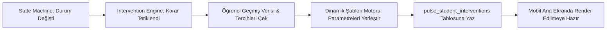
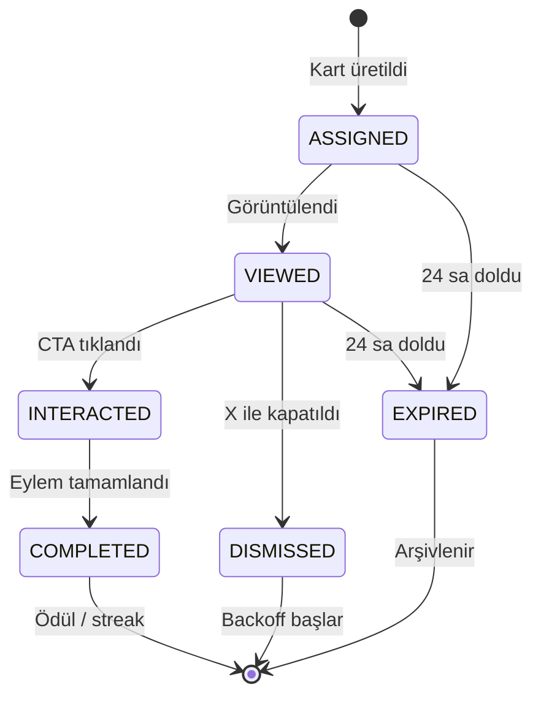

# 🎯 Doping Pulse: Müdahale Motoru ve Anket Orkestrasyonu Spesifikasyonu

**Doküman Kodu:** `RFC-PULSE-004`  
**Modül:** `Pulse Intervention & Content Recommendation Engine`  
**Yazar:** Hamza Kar  
**Amacı:** Öğrencinin bulunduğu duruma (`ACTIVATE`, `BOOST`, `RESTART`) göre en doğru mikro-görevi, adaptasyonu veya check-in anketini dinamik olarak üreten ve yöneten içerik orkestrasyonu.

---

## 1. Mimari Rol ve Sorumluluk Ayrımı

State Machine (`RFC-001`), öğrencinin durumunun ne olduğuna karar verir (Örn: `RESTART_CHECKIN_PENDING`).  
**Müdahale Motoru** ise şu soruları çözer:
1. *"Bu öğrenciye tam olarak hangi kartı göstermeliyiz?"*
2. *"Kartın başlığı, butonu ve yönlendireceği deep link ne olmalı?"* (Örn: Hangi ders, hangi video?)
3. *"Öğrenci anketi yanıtladığında platform öğrencinin hedeflerini arka planda nasıl dönüştürmeli?"*

> **Holdout Kuralı:** `experiment_arm = 'HOLDOUT'` olan öğrenciler için durum makinesi normal çalışır (shadow mode: durum hesaplanır, audit log yazılır) ancak Müdahale Motoru **kart üretmez**. Etki ölçümü bu karşılaştırmaya dayanır (RFC-007 §5).



---

## 2. Müdahale Tipleri ve İçerik Kataloğu

Sistem 4 temel müdahale arketipini destekler:

### 2.1. `MICRO_TASK` (Düşük Eşikli Mikro-Görev)
* **Kullanıldığı Durumlar:** `ACTIVATE`, `RESTART_ADAPTED`
* **Prensip:** Bilişsel yükü minimuma indirmek. Öğrenciye 2 saatlik ders programı dayatmak yerine "Sadece 4 dakika" diyerek eylemsizlik eşiğini kırmak.
* **Seçim Algoritması:**
  * Eğer öğrenci `ACTIVATE` aşamasındaysa: Müfredatın en popüler ve temel seviye giriş dersi seçilir (Örn: Matematik → "Temel Kavramlar 1").
  * Eğer öğrenci `RESTART` sonrası dönüş yapıyorsa: Kopmadan önce en son ≥ %50 izleyip bıraktığı videonun kalan kısmı önerilir.

### 2.2. `GOAL_ADAPTATION` (Dinamik Hedef Uyarlama)
* **Kullanıldığı Durumlar:** `BOOST_LOW_PACE`, `BOOST_STREAK_BROKEN`
* **Prensip:** Birikmiş ödev ve hedef baskısını hafifletmek.
* **Uygulama:** Günlük hedef soru sayısı varsayılan olarak %40 kırpılır (`factor: 0.6`, RFC-001 §4.2). Kart öğrenciye suçluluk hissettirmeden gösterilir:  
  *"Bugün yükünü hafiflettik. 25 soru yerine sadece 15 soru çözerek ritmini koru!"*

### 2.3. `CHECK_IN_SURVEY` (Kök Neden Anket Kartı)
* **Kullanıldığı Durumlar:** `RESTART_CHECKIN_PENDING`
* **Prensip:** Yargılamadan neden koptuğunu sormak ve öğrencinin seçtiği cevaba göre platformu öğrenciye uydurmak.

### 2.4. `MOTIVATION_CARD` (Streak & Tebrik Kartı)
* **Kullanıldığı Durumlar:** `STEADY_STREAK_HERO`
* **Prensip:** Mikro ödül mekanizması. Müdahale değil, pozitif pekiştirme (Örn: "3 gündür seridesin, ritmin harika gidiyor!").

---

## 3. Şablon İnterpolasyonu

Müdahale motoru, veritabanındaki şablon metinlerini öğrencinin bağlamına göre dinamik olarak zenginleştirir.

### Desteklenen Değişkenler:
| Değişken | Açıklama | Örnek Çıktı |
| :--- | :--- | :--- |
| `{{student.first_name}}` | Öğrencinin adı | "Ahmet" |
| `{{content.lesson_title}}` | Önerilen dersin adı | "Problemler - Sayı Kesir" |
| `{{content.duration_min}}` | Videonun kalan veya toplam süresi | "4" |
| `{{target.reduced_count}}` | Hafifletilmiş soru hedefi | "10" |
| `{{target.original_count}}` | Orijinal soru hedefi | "25" |

### Örnek Şablon Tanımı (`pulse_intervention_templates`):
```json
{
  "templateId": "ACTIVATE_MICRO_VIDEO_V1",
  "titleTemplate": "Selam {{student.first_name}}, sadece {{content.duration_min}} dakikanı ayır!",
  "bodyTemplate": "Büyük programları unut. Bugün sadece {{content.lesson_title}} videosunu izleyerek ilk adımı atalım.",
  "ctaText": "Hemen Başla ({{content.duration_min}} Dk)",
  "ctaDeepLink": "doping://lesson/{{content.lesson_id}}"
}
```

---

## 4. ReStart Check-In Anketi ve Survey-to-Action Matrisi

ReStart durumundaki bir öğrenci mini anketi yanıtladığında (`POST /pulse/checkins`), arka planda çalışan **Adaptasyon Orkestratörü** otomatik eylemler tetikler. Bu tablo, anket seçeneklerinin ve sonuç durumlarının **kanonik kaynağıdır** (RFC-001, RFC-003 ve OpenAPI bu enum'lara referans verir). Eylem sunucu tarafında seçenekten türetilir; istemci ayrıca eylem talep etmez.

| Anket Seçeneği | Açıklama | Tetiklenen Backend Eylemi | Sonuç Durumu | Öğrenciye Verilen Geri Bildirim |
| :--- | :--- | :--- | :--- | :--- |
| **`SCHOOL_EXAMS`** | "Okul sınavlarım / yazılılarım çok yoğundu." | **`ACTION_FREEZE_GOALS(days: 7)`**<br>Haftalık hedefler 7 gün dondurulur (`is_paused`, `paused_until = +7g`), öğrenciye sadece konu özet hapları açılır. | `RESTART_ADAPTED` | *"Sınav haftanı biliyoruz! Doping hedeflerini 7 gün dondurduk, sınavlarına odaklan."* |
| **`SUBJECT_DIFFICULTY`** | "Son çalıştığım konuyu anlamadım, moralim bozuldu." | **`ACTION_INJECT_PREREQUISITE(topic_id)`**<br>Zorlandığı konunun temel hazırlık videosu ve 3 kolay pekiştirme sorusu öne çıkarılır (adaptasyon süresi: 5 gün). | `RESTART_ADAPTED` | *"Zorlanman çok normal. Konunun temelini 5 dakikada anlatan hap videoyu hazırladık."* |
| **`BURNOUT`** | "Çok yoruldum, tempomu koruyamadım." | **`ACTION_SCALE_TARGETS(factor: 0.4, days: 5)`**<br>Hedefler 5 günlüğüne %60 hafifletilir. | `BOOST` / `BOOST_BURNOUT_RISK` | *"Biraz nefes alma vakti! Günlük hedefini 10 soruya indirdik, ritmi kaybetme yeter."* |
| **`TECHNICAL_ISSUE`** | "Uygulamada teknik bir sorun yaşadım." | **`ACTION_ESCALATE_SUPPORT(priority: HIGH)`**<br>Müşteri destek CRM'ine anında yüksek öncelikli bilet açılır; öğrenci destek SLA'sı boyunca (3 gün) değerlendirme dışı tutulur. | `RESTART_ADAPTED` | *"Teknik aksaklık için özür dileriz! Destek ekibimiz hemen seninle iletişime geçecek."* |
| **`OTHER`** | "Kişisel / Başka bir neden." | **`ACTION_RESET_TO_ACTIVATE`**<br>Program sıfırlanır ve öğrenciye "Temiz bir sayfa aç" seçeneği sunulur. | `ACTIVATE` / `ACTIVATE_ONBOARDING` | *"Hiç sorun değil. İstediğin zaman temiz bir sayfayla sıfırdan başlayabilirsin."* |

`RESTART_ADAPTED` durumundan çıkış: Ardışık 4 başarılı gün → `STEADY`; adaptasyon süresi bu koşul sağlanmadan dolarsa → `BOOST` (RFC-001 §3).

---

## 5. Müdahale Yaşam Döngüsü ve Backoff

Öğrencinin arayüzde kart spam'ine maruz kalmaması ve **bildirim yorgunluğuna** girmemesi için şu kurallar katı şekilde işletilir:



| Geçiş | Tetikleyici Olay | Açıklama |
| :--- | :--- | :--- |
| `ASSIGNED → VIEWED` | `IMPRESSION` | Kart mobil ana ekranda görüntülendi |
| `VIEWED → INTERACTED` | `CLICK_CTA` | Öğrenci kartın butonuna bastı |
| `INTERACTED → COMPLETED` | `COMPLETE` | Kartın hedeflediği eylem (video, test, anket) tamamlandı; ödül/streak tetiklenir |
| `VIEWED → DISMISSED` | `DISMISS` | Öğrenci kartı kapattı; backoff periyodu başlar (§5.1) |
| `ASSIGNED / VIEWED → EXPIRED` | Gece temizlik işi | 24 saatlik TTL doldu; kart arşivlenir |

### 5.1. Backoff Kuralları
1. **Günde En Fazla 1 Aktif Müdahale:** Öğrenciye aynı gün içinde asla birden fazla müdahale kartı sunulmaz (`active_intervention_id` doluyken yeni kart üretilmez).
2. **Dismissal Backoff:**
   * **1. Kapatma:** Sistem 24 saat boyunca yeni müdahale üretmez.
   * **2. Kapatma:** Sistem 48 saat boyunca yeni müdahale üretmez.
   * **3. Kapatma:** Sistem o öğrenci için push ve modal bildirimleri tamamen keser; müdahaleyi yalnızca ana ekranın en altında pasif bir "Tavsiye" kutusuna indirger.
3. **Kart TTL'i:** Bir kart üretildikten sonra en fazla **24 saat** geçerlidir. 24 saat içinde tamamlanmayan kartlar gece temizlik işiyle otomatik olarak `EXPIRED` durumuna alınır.

