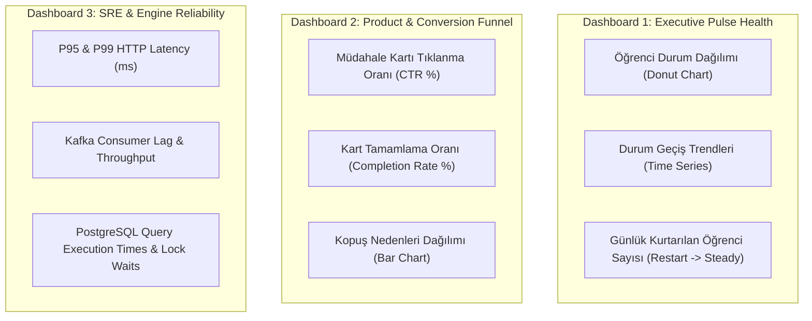

# 📊 Doping Pulse: Gözlemlenebilirlik, İzleme ve SLA Spesifikasyonu (Observability & SRE RFC)

**Doküman Kodu:** `RFC-PULSE-007`  
**Modül:** `Pulse Monitoring, Alerting & Site Reliability Engineering (SRE)`  
**Mimar:** Senior Backend Architect & Platform SRE Team  
**Teknoloji Yığını:** Prometheus, Grafana, OpenTelemetry, Alertmanager, Loki  
**Tasarım Hedefi:** Sistemin sağlığını, karar motorunun doğruluğunu ve yüzbinlerce öğrencinin durum dağılımını gerçek zamanlı izlemek.

---

## 1. Hizmet Düzeyi Hedefleri ve Taahhütleri (SLI / SLO / SLA)

Doping Pulse, öğrenci ana ekran deneyimini doğrudan etkileyen kritik bir servis olduğu için aşağıdaki hizmet seviyesi göstergeleri (SLI) garanti edilir:

| Metrik (SLI) | Hedef Seviye (SLO) | Ölçüm Penceresi | Açıklama |
| :--- | :--- | :--- | :--- |
| **Sistem Erişilebilirliği (Availability)** | **$\ge \%99.95$** | 30 Günlük Kayan Pencere | HTTP 5xx hata oranının $\%0.05$'in altında kalması. |
| **Mobil Ana Ekran Gecikmesi (P95)** | **$\le 30\text{ ms}$** | 5 Dakikalık Ortalama | `GET /pulse/me/status` isteğinin 95. yüzdelik yanıt süresi. |
| **Mobil Ana Ekran Gecikmesi (P99)** | **$\le 75\text{ ms}$** | 5 Dakikalık Ortalama | En uç kuyruk gecikmesi (Tail latency). |
| **Olay İşleme Gecikmesi (Kafka Latency)**| **$\le 250\text{ ms}$ (P99)** | Anlık | Video/Test bittiği andan durum güncellenmesine kadar geçen süre. |
| **Gece Toplu Tarama Süresi (Batch SLO)** | **$\le 45\text{ dakika}$** | Her Gece (03:00 - 03:45) | 500.000 aktif öğrencinin inaktivite analizinin tamamlanma süresi. |

---

## 2. Temel Prometheus Metrikleri (Metrics Catalog)

Uygulama, `/metrics` endpoint'i üzerinden Prometheus formatında hem iş (business) hem de sistem (infrastructure) metrikleri sunar:

### 2.1. İş ve Davranış Metrikleri (Business KPIs)

```prometheus
# Anlık öğrenci durum dağılımı (Gauge)
pulse_students_by_state{state="ACTIVATE", sub_state="ACTIVATE_STALLED"} 14205
pulse_students_by_state{state="BOOST", sub_state="BOOST_LOW_PACE"} 28410
pulse_students_by_state{state="RESTART", sub_state="RESTART_CHECKIN_PENDING"} 8912
pulse_students_by_state{state="STEADY", sub_state="STEADY_NORMAL"} 185420

# Durum geçiş sayacı (Counter)
pulse_state_transitions_total{from="ACTIVATE", to="STEADY", trigger="MILESTONE_COMPLETED"} 1450
pulse_state_transitions_total{from="STEADY", to="RESTART", trigger="NIGHTLY_INACTIVITY"} 320

# Müdahale dönüşüm hunisi (Intervention Funnel Counters)
pulse_intervention_events_total{template_id="ACTIVATE_FIRST_5M", type="IMPRESSION"} 8400
pulse_intervention_events_total{template_id="ACTIVATE_FIRST_5M", type="CLICK_CTA"} 3200
pulse_intervention_events_total{template_id="ACTIVATE_FIRST_5M", type="COMPLETE"} 2150
pulse_intervention_events_total{template_id="ACTIVATE_FIRST_5M", type="DISMISS"} 920

# ReStart anketi kök neden dağılımı (Counter)
pulse_checkin_responses_total{reason="SCHOOL_EXAMS"} 4120
pulse_checkin_responses_total{reason="SUBJECT_DIFFICULTY"} 1840
pulse_checkin_responses_total{reason="BURNOUT"} 1210
pulse_checkin_responses_total{reason="TECHNICAL_ISSUE"} 85
```

### 2.2. Sistem ve Altyapı Metrikleri (Engine Performance)

```prometheus
# API Gecikme Histogramı
pulse_http_request_duration_seconds_bucket{le="0.01", endpoint="/pulse/me/status"} 140291
pulse_http_request_duration_seconds_bucket{le="0.05", endpoint="/pulse/me/status"} 189210

# Kafka Tüketici Birikmesi (Consumer Lag)
pulse_kafka_consumer_lag_records{topic="learning.lesson.watched", partition="0"} 12

# PostgreSQL Bağlantı Havuzu
pulse_db_connections_active 18
pulse_db_connections_idle 32
pulse_db_connections_max 100
```

---

## 3. Grafana Dashboard Tasarımı

Operasyon ve ürün ekipleri için 3 ana dashboard paneli kurgulanmıştır:



---

## 4. Alarm Kuralları ve Eskalasyon Matrisi (Alerting Rules)

Alertmanager üzerinde tanımlı kurallar önem derecesine göre PagerDuty veya Slack kanalına yönlendirilir:

### 4.1. Sev-1 (Kritik / PagerDuty - Nöbetçi Mühendisi Uyandır)
1. **API Latency Degradation:**  
   * Koşul: `histogram_quantile(0.99, sum(rate(pulse_http_request_duration_seconds_bucket[5m])) by (le)) > 0.15` (150ms üzeri P99).  
   * Süre: 3 dakika boyunca sürerse.
2. **Yüksek Hata Oranı (High 5xx Rate):**  
   * Koşul: `sum(rate(pulse_http_requests_total{status=~"5.."}[5m])) / sum(rate(pulse_http_requests_total[5m])) > 0.01` ($>\%1$).
3. **Kafka Consumer Deadlock / Massive Lag:**  
   * Koşul: `sum(pulse_kafka_consumer_lag_records) > 25000` (Kuyrukta 25 binden fazla işlenmemiş olay birikmesi).

### 4.2. Sev-2 (Uyarı / Slack #pulse-alerts Kanalı)
1. **Anormal ReStart Sıçraması (Anomaly Detection):**  
   * Koşul: Günlük `STEADY` $\rightarrow$ `RESTART` geçiş adedi son 7 günün ortalamasından $\%35$ daha yüksekse. (Bir ders videosunun bozuk olması veya sistemik bir hata ihtimaline işaret eder).
2. **Dead-Letter Queue (DLQ) Uyarısı:**  
   * Koşul: `pulse_dlq_messages_total > 5` (Hata kuyruğuna mesaj düştüğü an).
3. **Gece Taraması Süre Aşımı (Nightly Batch Delay):**  
   * Koşul: Gece inaktivite tarama işi 60 dakikadan uzun sürerse.

